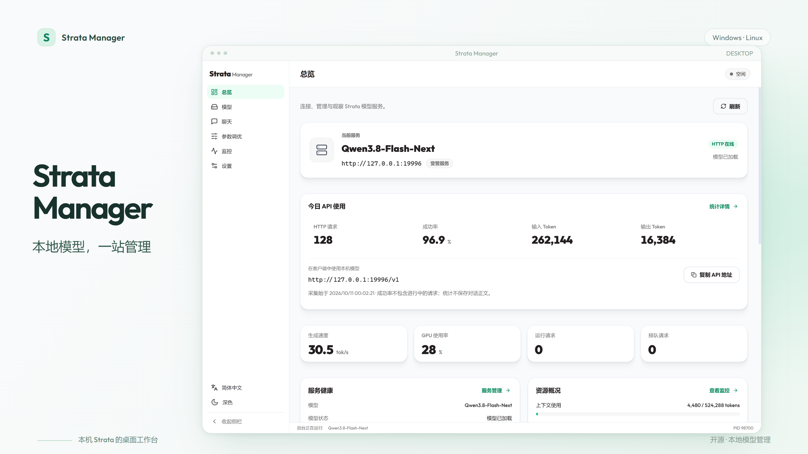
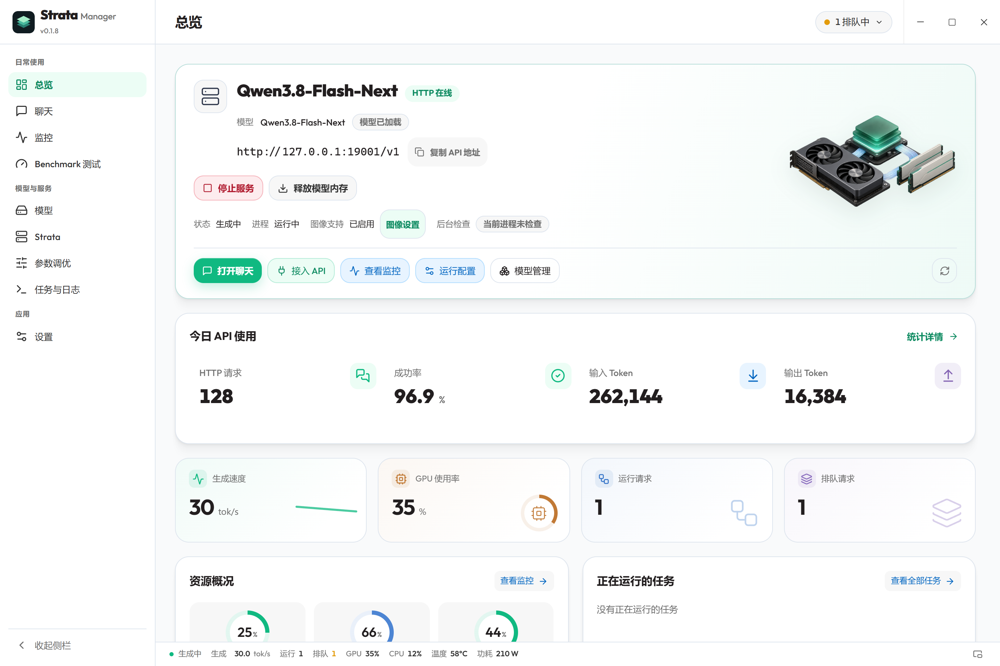
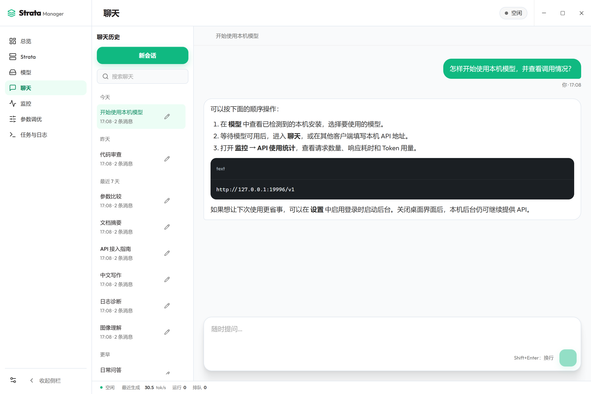
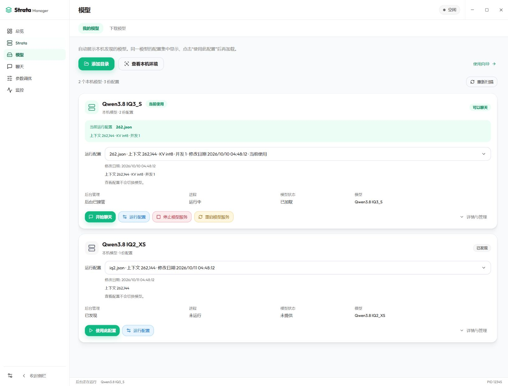
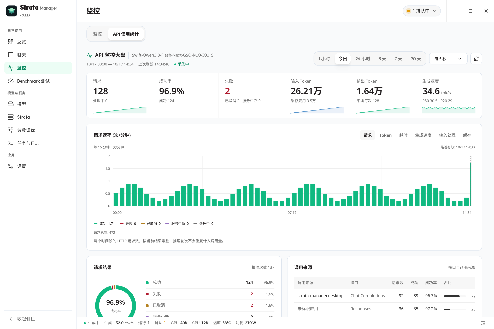
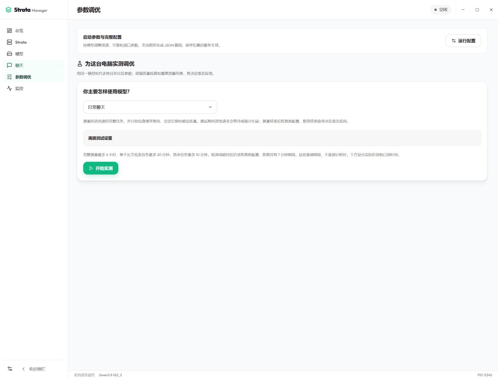
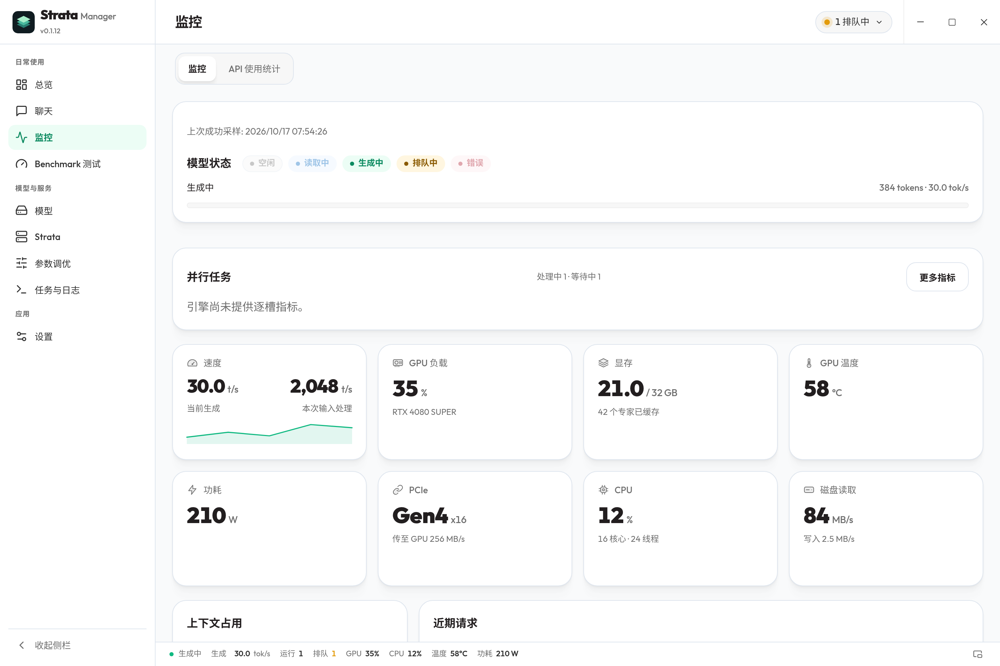
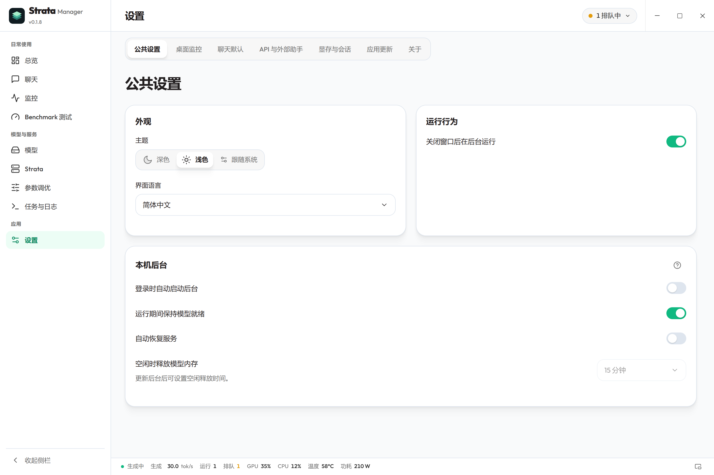

<div align="center">

<a href="https://raw.githubusercontent.com/hongfaqiu/strata-manager/main/docs/screenshots/product-cover.webp"></a>

<h1>Strata Manager</h1>
<p><strong>Local models. One workspace.</strong></p>
<p>A desktop home for your Strata models, conversations and local API.</p>

<p>
<a href="LICENSE"></a>
<a href="https://tauri.app/"></a>

<a href="README.md"></a>
<a href="https://github.com/hongfaqiu/strata-manager/actions/workflows/ci.yml"></a>
</p>

<p><a href="https://hongfaqiu.github.io/strata-manager/">Website</a> · <a href="README.md">简体中文</a> · <a href="#download">Download</a> · <a href="#get-started">Get started</a> · <a href="#features">Features</a> · <a href="#screenshots">Screenshots</a> · <a href="docs/USER_GUIDE.en.md">User guide</a></p>

</div>

**First release under verification; try [source](#build-from-source) or [current Linux CI artifacts](https://github.com/hongfaqiu/strata-manager/actions/runs/38066271017).** See the [verification record](docs/VERIFICATION.md).

Strata Manager brings [Strata](https://github.com/Niko1221/Strata) and its supported models into one local workspace. Import what you already have, prepare a new model when you need one, and use it from Chat or your favorite API client. Available models and API capabilities depend on your installed Strata runtime.

## Features

- **Keep existing models.** Detect and import local Strata installations without downloading their weights again.
- **Skip the setup chores.** Prepare the official runtime and a private Python environment through the app, without finding Git or entering Python paths.
- **Keep your API available.** An independent background process manages startup and reconnects when you reopen the desktop window.
- **Chat in one place.** Conversation history, streaming replies, text and image attachments, reasoning and MCP tools share the same workspace.
- **Understand your usage.** Follow request volume, tokens, latency, cache reuse, errors and activity over time, with unknown values clearly identified.
- **Tune with measurements.** Compare a baseline and candidate, review the result, then apply it or restore the original settings.

Chinese and English, light and dark themes, a collapsible sidebar, tray actions, startup settings and update controls make the workspace fit daily use. The interface follows Strata's visual style.

## Download

The [Releases page](https://github.com/hongfaqiu/strata-manager/releases) will host verified releases. **No first official release is available yet.**

| Platform | Preview option | Planned release package |
| --- | --- | --- |
| Windows x64 | Build from source; installer verification is still in progress | `*-setup.exe` |
| Linux x64 | [Current CI artifacts](https://github.com/hongfaqiu/strata-manager/actions/runs/38066271017) or source | `*.AppImage` / `*.deb` |

CI packages are preview builds, not formal releases. Linux builds target Ubuntu 22.04; real Linux installation and GPU use still need acceptance. Windows requires WebView2. macOS and ARM are currently outside the release targets.

The desktop package does not include model weights. Hardware, drivers and free disk space depend on the model; check [Strata's requirements](https://github.com/Niko1221/Strata#what-you-need) before preparing one.

## Get started

1. **Have a model already? Open My models.** Valid models and conversations from earlier Manager versions are restored automatically. Import another detected local Strata installation, selecting its folder only if detection misses it. Existing model files stay in place and do not need another download.
2. **Need a new model? Follow preparation.** Let the app prepare the runtime, then choose the model, size, context and image support. Follow the task log; cancel or retry when needed. Only download new weights when you choose to add them. Verified results appear in My models without replacing your current selection.
3. **Choose Use, wait for Model ready, then chat.** Service startup is handled by the app. To connect another application, copy the local API address and use its matching API path. Closing the window keeps an already running service available; use the tray's Stop services and quit action to stop it.

Only installations prepared or imported on **this computer** are managed. See the [user guide](docs/USER_GUIDE.en.md) for preparation requirements, background behavior, API connections and troubleshooting.

## Screenshots

These are actual App screens rendered with isolated in-memory RPC example data. Model status, chat content and metrics are examples disclosed here outside the images, not live inference results or benchmarks. The cover combines these screens and is not performance evidence. Screenshots use 2× pixel density and lossless WebP; click any image to open its full-resolution version.

**Your workspace at a glance**

[](https://raw.githubusercontent.com/hongfaqiu/strata-manager/main/docs/screenshots/overview.zh.webp)

**Conversations, attachments and tools**

[](https://raw.githubusercontent.com/hongfaqiu/strata-manager/main/docs/screenshots/chat.zh.webp)

<details>
<summary>Explore models, API usage, tuning, monitoring and settings</summary>

**Models — reuse what you have, prepare what you need**

[](https://raw.githubusercontent.com/hongfaqiu/strata-manager/main/docs/screenshots/models.zh.webp)

**API usage — see how your local service is used**

[](https://raw.githubusercontent.com/hongfaqiu/strata-manager/main/docs/screenshots/usage.zh.webp)

**Tuning — compare before choosing**

[](https://raw.githubusercontent.com/hongfaqiu/strata-manager/main/docs/screenshots/tuning.zh.webp)

**Monitor — inspect service and hardware activity**

[](https://raw.githubusercontent.com/hongfaqiu/strata-manager/main/docs/screenshots/monitor.zh.webp)

**Settings — make the workspace yours**

[](https://raw.githubusercontent.com/hongfaqiu/strata-manager/main/docs/screenshots/settings.zh.webp)

</details>

## Learn more

The [user guide](docs/USER_GUIDE.en.md) explains API counters, local storage and privacy, tuning limits, startup and updates, and common problems. For version acceptance and current limitations, see the [verification record](docs/VERIFICATION.md).

<details>
<summary>Build from source</summary>

### Build from source

Use Node.js **22.13+** (CI uses 24), pnpm **11.21.0** and Rust stable. Windows needs MSVC C++ Build Tools, Windows SDK and WebView2; Linux dependencies are listed in [Tauri's prerequisites](https://v2.tauri.app/start/prerequisites/).

```sh
git clone https://github.com/hongfaqiu/strata-manager.git
cd strata-manager
pnpm install --frozen-lockfile
pnpm desktop       # Start the desktop app and its background process
pnpm check         # Check types, protocol tests and frontend build
pnpm native:test   # Run Rust workspace tests
pnpm bundle        # Build a local installer
```

Local builds do not constitute official signed releases. Maintainers can refer to the [release guide](docs/RELEASING.md).

See the [development guide](docs/DEVELOPMENT.md) for source layout and checks.

</details>

## Credits and license

Built on [Niko1221/Strata](https://github.com/Niko1221/Strata), with its official interface style and capabilities. Thank you to the upstream author and contributors. Strata Manager is an independent community desktop application.

Strata Manager uses [MIT](LICENSE); reused Strata resources retain their MIT attribution. The bundled Outfit font uses SIL OFL 1.1. See [third-party notices](THIRD_PARTY_NOTICES.md). Model weights are installed separately and retain their providers' licenses.
