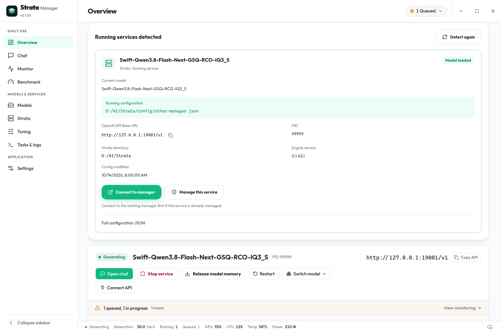
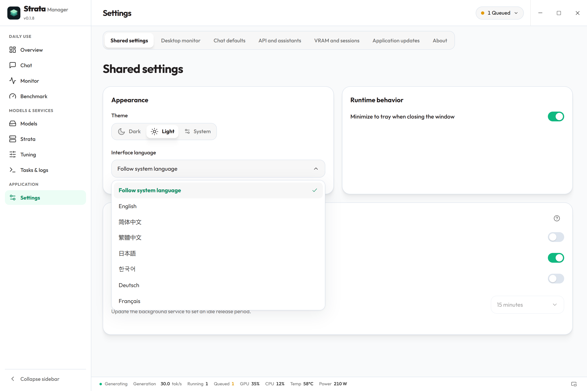

<div align="center">


<h1>Strata Manager</h1>
<p><strong>A desktop workspace for local inference with Strata.</strong><br />Prepare the runtime, manage models and services, and understand how your local API is running.</p>

<p>
<a href="https://hongfaqiu.github.io/strata-manager/en/"><strong>Website</strong></a> ·
<a href="https://hongfaqiu.github.io/strata-manager/docs/index.en.html"><strong>Documentation</strong></a> ·
<a href="docs/SYSTEM.en.md">System explanation</a> ·
<a href="https://github.com/hongfaqiu/strata-manager/releases/latest"><strong>Latest stable release</strong></a> ·
<a href="CHANGELOG.md">Changelog</a> ·
<a href="README.zh-CN.md">简体中文</a>
</p>

<p>
<a href="LICENSE"></a>


<a href="https://github.com/hongfaqiu/strata-manager/actions/workflows/ci.yml"></a>
</p>

</div>

**Strata Manager is an open-source desktop management app for [Niko1221/Strata](https://github.com/Niko1221/Strata), a local large language model inference engine.** It brings runtime setup, model configurations, service controls, chat, monitoring, tuning and benchmarking into one workspace. Existing supported model weights stay in place.

[](https://raw.githubusercontent.com/hongfaqiu/strata-manager/main/docs/screenshots/product-cover.en.webp)

<sub>0.1.9 release candidate interface, refreshed on October 14, 2026. The homepage cover shows the complete Overview with the top-right service status closed. Publication is pending. Screenshots use the actual application and components with isolated example data; displayed values are not inference results or benchmarks. Click to view the original.</sub>

## What is Strata, and what does Manager do?

[Strata](https://github.com/Niko1221/Strata) is an open-source local LLM inference engine. It coordinates GPU memory, RAM and CPU resources to run supported models, and provides a browser interface and a local API.

| Component | Responsibility |
| --- | --- |
| **Strata runtime** | Load models, execute inference and provide the API. Supported models, image input and protocols depend on the installed engine and chosen model. |
| **Strata Manager** | Prepare and inspect the runtime, manage local models and configurations, control services, and present chat, monitoring, tuning and benchmarking tools. |
| **Your applications** | Connect to the running local API to use the model. |

Manager is an independent community project. It manages supported Strata installations on **this computer**; the runtime and model weights are installed separately.

## A workflow from setup to daily use

This overview covers the current source; stable installers include the features listed in their release notes. Engine-dependent tools appear according to the installed runtime's capabilities.

| Workflow | What you can do |
| --- | --- |
| **1 · Prepare Strata** | Detect installations and inspect local/upstream versions and release notes. Windows x64 engine ZIPs default to official GitHub, offer GH Proxy/GHProxy, custom HTTPS or local ZIP sources, and match the current CUDA12, CUDA13 or HIP engine across sources. Interrupted downloads retain partial data and attempt HTTP Range resume; complete packages are checked against official size and SHA256. Linux supports environment scans, versions and release notes. |
| **2 · Organize models** | Discover local weights, group configurations by model, choose download sources and GPUs, and inspect model files, GGUF metadata and disk usage. Supported formats include Swift IQ3_S. |
| **3 · Configure and run** | Edit graphical controls or JSON with validation and backups. Start, stop, restart or release model memory; follow startup stages, tasks and logs. On Windows, inspect detected running services, their loaded state, API address and configuration; reconnect to their existing Manager backend or take ownership. Opening Manager or signing in starts only the lightweight background, preserving stopped services. |
| **4 · Chat and integrate** | Use streaming conversations, attachments and structured output. New models inherit shared generation parameters and MCP defaults; existing custom values remain separate until inheritance is enabled. Changes apply to the next chat request. Configure connection targets, the application's access key, API examples and MCP in API and external assistants; selecting a target does not start or switch a model. |
| **5 · Inspect sessions and load** | Save and restore engine sessions; inspect slots, load, hardware and supported VRAM adjustments. The status panel separates recent generation and input-processing trends, preserving sample gaps, and shows automatic model reload progress after idle memory release. The desktop monitor is closed by default, with three layouts, ordered metrics and text/color controls; its context menu provides navigation, pinning and sampling, with optional system-tray monitoring. Read-only observation never starts or restores services; quick speed tests send inference requests. |
| **6 · Understand usage and tune** | Retain local API metadata, support Strata 0.1.44 API usage statistics, and chart requests, tokens, latency and cache reuse. Compare complete chat, coding/Agent or document tasks before applying or restoring supported tuning candidates; no fixed performance gain is promised. |
| **7 · Benchmark** | Run verified context tiers or seven scenario tests serially. Record token counts, prefill/decode rates, TTFT, duration and resource samples; review history, export JSON/CSV, copy report images or export PNG. Coordinate tests with other inference operations. |
| **8 · Review updates and preferences** | Manage app and Strata updates separately from model weights. The dedicated app update page provides bundled bilingual notes offline, stable update checks and installation confirmation with Tauri signature verification. Follow the system language or choose one of ten bundled interface languages; use system/light/dark appearance and tray controls. Some advanced tools and original service logs use English. |

API usage statistics work without capturing request bodies. Optional temporary body diagnostics are separate; see the [user guide](docs/USER_GUIDE.en.md) for behavior and privacy.

See the [system explanation](docs/SYSTEM.en.md) for component relationships and persistence, and [CHANGELOG.md](CHANGELOG.md) or the [website changelog](https://hongfaqiu.github.io/strata-manager/docs/changelog.en.html) for version-specific changes.

## 0.1.9 release candidate

Version **0.1.9 is a release candidate, pending publication**. It brings the following changes; package availability is established by the [release page](https://github.com/hongfaqiu/strata-manager/releases/latest), and installer acceptance is recorded separately from interface screenshots.

- **Multi-GPU selection and calibrate entry.** Download settings can pick GPU indices graphically; the official `--calibrate` control only prepares a terminal command and never runs calibration inside the app. The API wizard adds Cursor / Codex examples, and startup settings expose quick batch / parallel controls. The observer supports Strata 0.1.44.1 and detects newer upstream versions structurally (degrading to public endpoints when the contract changes), so most upstream releases need no app update; the environment page can run the official `update.sh` / `UPDATE.bat`.
- **Running services on Windows.** Inspect the actual loaded state, current model, running configuration, PID, engine version and OpenAI API Base URL. Connect to an existing Manager backend first; taking ownership of a plain external service can reload the model. Automatic connection requires an empty backend and a single unambiguous running service. Automatic takeover additionally requires a healthy, loaded, idle model; multiple candidates remain available for manual selection.
- **System language and bundled language packs.** First launch offers language confirmation. Choose English, Simplified/Traditional Chinese, Japanese, Korean, German, French, Spanish, Portuguese or Russian, or follow the system language. Packs are included in the app; an existing explicit choice is preserved. Some advanced tools and original logs remain in English.
- **A configurable desktop monitor.** Show or hide it with a switch. Two rows are the default; compact and panel layouts are also available, with 8–36px text and 1–8 ordered metrics from eleven. Labels default on; status text and edge snapping default off. Control units, sample time and graphs, customize each metric's color or restore its theme default, and drag the strip. Stable column widths reduce empty space; prefill is blue and generation green, and idle history is never plotted as a new live sample. Short settings labels use tooltips for details. The taskbar-mode switch is removed, and older preferences migrate to floating mode.
- **Clearer loading and controls.** A request that reloads an idle-released model shows loading progress and elapsed time in the status bar. Rounded workspace tabs and simplified selection controls are shared across the interface.

| Detected running services | System language and language packs |
| --- | --- |
| [](docs/screenshots/running-services.en.webp) | [](docs/screenshots/language-settings.en.webp) |

Screenshots remain from the 2026-10-14 gallery covering the 0.1.9 candidate source on October 14, 2026; see the [capture record](docs/screenshots/README.md). Native window behavior, real GPU capacity, prolonged stability and cross-device LAN access have separate [verification records](docs/VERIFICATION.md).

## Download and get started

### Daily workflows introduced in 0.1.7

The [0.1.7 release](https://github.com/hongfaqiu/strata-manager/releases/tag/v0.1.7) adds a model download list and details, unified GPU/run options, resource assessment for the current selection, startup diagnostics, four capability states, chat request timing, explicit API verification and historical benchmark condition comparisons. Saved settings do not prove live engine support; missing evidence remains unverified, and settings that require a restart are identified separately. Verification never starts an unready model automatically.

These workflows continue in 0.1.9. See the [daily experience notes](docs/DAILY_EXPERIENCE.md) and [verification record](docs/VERIFICATION.md). The images below were recaptured from current components with isolated example data; they do not establish acceptance of the 0.1.9 candidate installer or measured inference performance.

| Model downloads and resource selection | API verification and capabilities |
| --- | --- |
| [](docs/screenshots/daily-experience/model-download-detail.en.webp) | [](docs/screenshots/daily-experience/api-verification.en.webp) |

### Stable installers

Choose a package from the [latest stable release](https://github.com/hongfaqiu/strata-manager/releases/latest) or the [website download section](https://hongfaqiu.github.io/strata-manager/en/#get-started). Install only files listed for the selected release and verify them against that release's `SHA256SUMS`.

| Platform | Package | Setup |
| --- | --- | --- |
| **Windows x64** | NSIS installer (`.exe`) | Requires WebView2. [Windows installation](docs/DOWNLOAD.en.md#install-on-windows). |
| **Linux x64** | AppImage or DEB | Built in Ubuntu 22.04 CI. [Linux installation and support scope](docs/DOWNLOAD.en.md#install-on-linux). |

1. **Prepare the runtime.** Open Strata to inspect an existing installation or follow the setup guide. An existing supported runtime does not need reinstalling.
2. **Choose a model and configuration.** My models lists discovered weights. Add a search directory when needed, select a configuration, or download new weights.
3. **Choose Use.** Follow environment checks and loading until Model ready, then chat or copy the local API address into another application.

The desktop installer contains Manager and its background process. Hardware and driver requirements depend on Strata and the model. macOS and ARM are outside the current release targets. Detailed steps and package limitations are in the [download guide](docs/DOWNLOAD.en.md); everyday use is covered in the [user guide](docs/USER_GUIDE.en.md).

## Explore the workspace

All images below show the current application and components with isolated documentation data, in the light theme. Click an image for full resolution.

| Models and configurations | Hardware and inference monitoring |
| --- | --- |
| [](https://raw.githubusercontent.com/hongfaqiu/strata-manager/main/docs/screenshots/models.en.webp) | [](https://raw.githubusercontent.com/hongfaqiu/strata-manager/main/docs/screenshots/monitor.en.webp) |

<details>
<summary><strong>More interfaces: runtime, chat, shared settings, connections, updates, benchmarking and monitoring</strong></summary>

**Strata — runtime versions and updates**

[](https://raw.githubusercontent.com/hongfaqiu/strata-manager/main/docs/screenshots/runtime.en.webp)

**Configuration — graphical controls and JSON**

[](https://raw.githubusercontent.com/hongfaqiu/strata-manager/main/docs/screenshots/config.en.webp)

**API usage — requests, tokens and cache trends**

[](https://raw.githubusercontent.com/hongfaqiu/strata-manager/main/docs/screenshots/usage.en.webp)

**Chat — conversations, streaming and attachments**

[](https://raw.githubusercontent.com/hongfaqiu/strata-manager/main/docs/screenshots/chat.en.webp)

**Tuning — compare tasks and candidates**

[](https://raw.githubusercontent.com/hongfaqiu/strata-manager/main/docs/screenshots/tuning.en.webp)

**Benchmark — context tiers and historical conditions**

[](https://raw.githubusercontent.com/hongfaqiu/strata-manager/main/docs/screenshots/benchmark.en.webp)

[](docs/screenshots/daily-experience/history-comparison.en.webp)

**Settings and About**

[](https://raw.githubusercontent.com/hongfaqiu/strata-manager/main/docs/screenshots/settings.en.webp)

[](https://raw.githubusercontent.com/hongfaqiu/strata-manager/main/docs/screenshots/about.en.webp)

**Shared chat defaults — per-model inheritance**

[](https://raw.githubusercontent.com/hongfaqiu/strata-manager/main/docs/screenshots/common-chat-settings.en.webp)

**Connections — API and external assistants**

[](https://raw.githubusercontent.com/hongfaqiu/strata-manager/main/docs/screenshots/connections.en.webp)

**Application updates — bilingual notes and installation confirmation**

[](https://raw.githubusercontent.com/hongfaqiu/strata-manager/main/docs/screenshots/app-updates.en.webp)

**Service status — recent generation and input-processing trends**

[](https://raw.githubusercontent.com/hongfaqiu/strata-manager/main/docs/screenshots/service-status.en.webp)

**Independent desktop monitor — closed by default**

[](https://raw.githubusercontent.com/hongfaqiu/strata-manager/main/docs/screenshots/floating-monitor.en.webp)

[](docs/screenshots/floating-monitor-settings.en.webp)

</details>

## Common questions

**Will closing the window stop the API?** Closing to the tray is enabled by default, so a running service remains available. Disable it to stop managed services and exit on close, or use Stop services and quit from the tray.

**Does releasing model memory delete the model?** No. It releases RAM/VRAM while retaining model files and the API process. Removing a saved configuration also preserves the original weights.

**Is everything offline?** Chats and usage records are stored locally. Downloads and updates use the network; configured MCP tools may contact external services. Review tools before enabling them and remove private content before sharing diagnostics.

For API connections, diagnostics and tuning limits, see the [user guide](docs/USER_GUIDE.en.md). Report problems in [Issues](https://github.com/hongfaqiu/strata-manager/issues).

<details>
<summary><strong>Build from source</strong></summary>

Use Node.js **22.13+**, pnpm **11.21.0** and Rust stable. Windows requires MSVC C++ Build Tools, Windows SDK and WebView2; Linux dependencies are listed in [Tauri's prerequisites](https://v2.tauri.app/start/prerequisites/).

```sh
git clone https://github.com/hongfaqiu/strata-manager.git
cd strata-manager
pnpm install --frozen-lockfile
pnpm desktop
```

Maintainers can refer to [development](docs/DEVELOPMENT.md), [release](docs/RELEASING.md) and [verification](docs/VERIFICATION.md) records.

</details>

## Credits and license

Built on [Niko1221/Strata](https://github.com/Niko1221/Strata). Thank you to the upstream author and contributors. Strata Manager is an independent community desktop application.

Strata Manager uses [MIT](LICENSE); reused resources retain upstream attribution. The bundled Outfit font uses SIL OFL 1.1. See [third-party notices](THIRD_PARTY_NOTICES.md). Model weights retain their providers' licenses.
