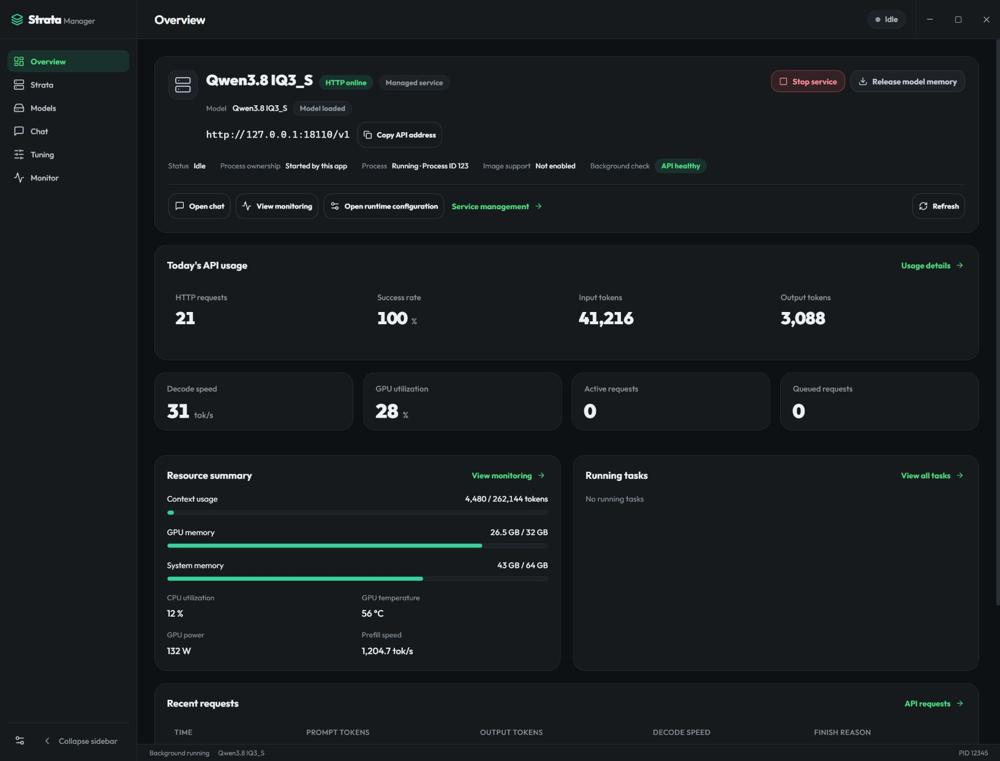

<div align="center">


<h1>Strata Manager</h1>
<p><strong>A desktop workspace for local inference with Strata.</strong><br />Prepare the runtime, manage models and services, and understand how your local API is running.</p>

<p>
<a href="https://hongfaqiu.github.io/strata-manager/en/"><strong>Website</strong></a> ·
<a href="https://hongfaqiu.github.io/strata-manager/docs/index.en.html"><strong>Documentation</strong></a> ·
<a href="docs/SYSTEM.en.md">System explanation</a> ·
<a href="https://github.com/hongfaqiu/strata-manager/releases/latest"><strong>Latest stable release</strong></a> ·
<a href="CHANGELOG.md">Changelog</a> ·
<a href="README.zh-CN.md">简体中文</a>
</p>

<p>
<a href="LICENSE"></a>


<a href="https://github.com/hongfaqiu/strata-manager/actions/workflows/ci.yml"></a>
</p>

</div>

**Strata Manager is an open-source desktop management app for [Niko1221/Strata](https://github.com/Niko1221/Strata), a local large language model inference engine.** It brings runtime setup, model configurations, service controls, chat, monitoring, tuning and benchmarking into one workspace. Existing supported model weights stay in place.

[](https://raw.githubusercontent.com/hongfaqiu/strata-manager/main/docs/screenshots/overview.en.webp)

<sub>Overview of the current app. Screenshots use real application components with isolated example data; displayed values are not inference results or benchmarks.</sub>

## What is Strata, and what does Manager do?

[Strata](https://github.com/Niko1221/Strata) is an open-source local LLM inference engine. It coordinates GPU memory, RAM and CPU resources to run supported models, and provides a browser interface and a local API.

| Component | Responsibility |
| --- | --- |
| **Strata runtime** | Load models, execute inference and provide the API. Supported models, image input and protocols depend on the installed engine and chosen model. |
| **Strata Manager** | Prepare and inspect the runtime, manage local models and configurations, control services, and present chat, monitoring, tuning and benchmarking tools. |
| **Your applications** | Connect to the running local API to use the model. |

Manager is an independent community project. It manages supported Strata installations on **this computer**; the runtime and model weights are installed separately.

## A workflow from setup to daily use

Engine-dependent tools appear according to the installed runtime's capabilities.

| Workflow | What you can do |
| --- | --- |
| **1 · Prepare Strata** | Detect installations and inspect local/upstream versions and release notes. Windows x64 engine ZIPs default to official GitHub, offer GH Proxy/GHProxy, custom HTTPS or local ZIP sources, and match the current CUDA12, CUDA13 or HIP engine across sources. Interrupted downloads retain partial data and attempt HTTP Range resume; complete packages are checked against official size and SHA256. Linux supports environment scans, versions and release notes. |
| **2 · Organize models** | Discover local weights, group configurations by model, choose download sources and GPUs, and inspect model files, GGUF metadata and disk usage. Supported formats include Swift IQ3_S. |
| **3 · Configure and run** | Edit graphical controls or JSON with validation and backups. Start, stop, restart or release model memory; follow startup stages, tasks and logs. Opening Manager or signing in starts only the lightweight background, preserving stopped services. |
| **4 · Chat and integrate** | Use streaming conversations, attachments and structured output. New models inherit shared generation parameters and MCP defaults; existing custom values remain separate until inheritance is enabled. Changes apply to the next chat request. Configure connection targets, the application's access key, API examples and MCP in API and external assistants; selecting a target does not start or switch a model. |
| **5 · Inspect sessions and load** | Save and restore engine sessions; inspect slots, load, hardware and supported VRAM adjustments. The status panel separates recent generation and input-processing trends, preserving sample gaps. An independent desktop monitor is closed by default; open, move, resize or pin it when needed. It observes an existing background without starting or restoring services. |
| **6 · Understand usage and tune** | Retain local API metadata, support Strata 0.1.43 API usage statistics, and chart requests, tokens, latency and cache reuse. Compare complete chat, coding/Agent or document tasks before applying or restoring supported tuning candidates; no fixed performance gain is promised. |
| **7 · Benchmark** | Set repeated runs, warmup and prompt/output lengths in the Benchmark workspace; test cache reuse with repeated inputs. Record time to first token (TTFT), request duration, P50/P95, token counts and engine rates separately. Cancel tests, review report history, export JSON and coordinate with other inference operations. |
| **8 · Review updates** | Manage app and Strata updates separately from model weights. The dedicated app update page provides bundled bilingual notes offline, stable update checks and installation confirmation with Tauri signature verification. Use Chinese/English, system/light/dark appearance and tray controls. |

API usage statistics work without capturing request bodies. Optional temporary body diagnostics are separate; see the [user guide](docs/USER_GUIDE.en.md) for behavior and privacy.

See the [0.1.4 system explanation](docs/SYSTEM.en.md) for component relationships and persistence, and [CHANGELOG.md](CHANGELOG.md) or the [website changelog](https://hongfaqiu.github.io/strata-manager/docs/changelog.en.html) for version-specific changes.

## Download and get started

Choose a package from the [latest stable release](https://github.com/hongfaqiu/strata-manager/releases/latest) or the [website download section](https://hongfaqiu.github.io/strata-manager/en/#get-started). Install only files listed for the selected release and verify them against that release's `SHA256SUMS`.

| Platform | Package | Setup |
| --- | --- | --- |
| **Windows x64** | NSIS installer (`.exe`) | Requires WebView2. [Windows installation](docs/DOWNLOAD.en.md#install-on-windows). |
| **Linux x64** | AppImage or DEB | Built in Ubuntu 22.04 CI. [Linux installation and support scope](docs/DOWNLOAD.en.md#install-on-linux). |

1. **Prepare the runtime.** Open Strata to inspect an existing installation or follow the setup guide. An existing supported runtime does not need reinstalling.
2. **Choose a model and configuration.** My models lists discovered weights. Add a search directory when needed, select a configuration, or download new weights.
3. **Choose Use.** Follow environment checks and loading until Model ready, then chat or copy the local API address into another application.

The desktop installer contains Manager and its background process. Hardware and driver requirements depend on Strata and the model. macOS and ARM are outside the current release targets. Detailed steps and package limitations are in the [download guide](docs/DOWNLOAD.en.md); everyday use is covered in the [user guide](docs/USER_GUIDE.en.md).

## Explore the workspace

All images below are real app components rendered with isolated documentation data, in the light theme. Click an image for full resolution.

| Models and configurations | Hardware and inference monitoring |
| --- | --- |
| [](https://raw.githubusercontent.com/hongfaqiu/strata-manager/main/docs/screenshots/models.en.webp) | [](https://raw.githubusercontent.com/hongfaqiu/strata-manager/main/docs/screenshots/monitor.en.webp) |

<details>
<summary><strong>More interfaces: runtime, chat, shared settings, connections, updates and monitoring</strong></summary>

**Strata — runtime versions and updates**

[](https://raw.githubusercontent.com/hongfaqiu/strata-manager/main/docs/screenshots/runtime.en.webp)

**Configuration — graphical controls and JSON**

[](https://raw.githubusercontent.com/hongfaqiu/strata-manager/main/docs/screenshots/config.en.webp)

**API usage — requests, tokens and cache trends**

[](https://raw.githubusercontent.com/hongfaqiu/strata-manager/main/docs/screenshots/usage.en.webp)

**Chat — conversations, streaming and attachments**

[](https://raw.githubusercontent.com/hongfaqiu/strata-manager/main/docs/screenshots/chat.en.webp)

**Tuning — compare tasks and candidates**

[](https://raw.githubusercontent.com/hongfaqiu/strata-manager/main/docs/screenshots/tuning.en.webp)

**Settings and About**

[](https://raw.githubusercontent.com/hongfaqiu/strata-manager/main/docs/screenshots/settings.en.webp)

[](https://raw.githubusercontent.com/hongfaqiu/strata-manager/main/docs/screenshots/about.en.webp)

**Shared chat defaults — per-model inheritance**

[](https://raw.githubusercontent.com/hongfaqiu/strata-manager/main/docs/screenshots/common-chat-settings.en.webp)

**Connections — API and external assistants**

[](https://raw.githubusercontent.com/hongfaqiu/strata-manager/main/docs/screenshots/connections.en.webp)

**Application updates — bilingual notes and installation confirmation**

[](https://raw.githubusercontent.com/hongfaqiu/strata-manager/main/docs/screenshots/app-updates.en.webp)

**Service status — recent generation and input-processing trends**

[](https://raw.githubusercontent.com/hongfaqiu/strata-manager/main/docs/screenshots/service-status.en.webp)

**Independent desktop monitor — closed by default**

[](https://raw.githubusercontent.com/hongfaqiu/strata-manager/main/docs/screenshots/floating-monitor.en.webp)

</details>

## Common questions

**Will closing the window stop the API?** Closing to the tray is enabled by default, so a running service remains available. Disable it to stop managed services and exit on close, or use Stop services and quit from the tray.

**Does releasing model memory delete the model?** No. It releases RAM/VRAM while retaining model files and the API process. Removing a saved configuration also preserves the original weights.

**Is everything offline?** Chats and usage records are stored locally. Downloads and updates use the network; configured MCP tools may contact external services. Review tools before enabling them and remove private content before sharing diagnostics.

For API connections, diagnostics and tuning limits, see the [user guide](docs/USER_GUIDE.en.md). Report problems in [Issues](https://github.com/hongfaqiu/strata-manager/issues).

<details>
<summary><strong>Build from source</strong></summary>

Use Node.js **22.13+**, pnpm **11.21.0** and Rust stable. Windows requires MSVC C++ Build Tools, Windows SDK and WebView2; Linux dependencies are listed in [Tauri's prerequisites](https://v2.tauri.app/start/prerequisites/).

```sh
git clone https://github.com/hongfaqiu/strata-manager.git
cd strata-manager
pnpm install --frozen-lockfile
pnpm desktop
```

Maintainers can refer to [development](docs/DEVELOPMENT.md), [release](docs/RELEASING.md) and [verification](docs/VERIFICATION.md) records.

</details>

## Credits and license

Built on [Niko1221/Strata](https://github.com/Niko1221/Strata). Thank you to the upstream author and contributors. Strata Manager is an independent community desktop application.

Strata Manager uses [MIT](LICENSE); reused resources retain upstream attribution. The bundled Outfit font uses SIL OFL 1.1. See [third-party notices](THIRD_PARTY_NOTICES.md). Model weights retain their providers' licenses.
