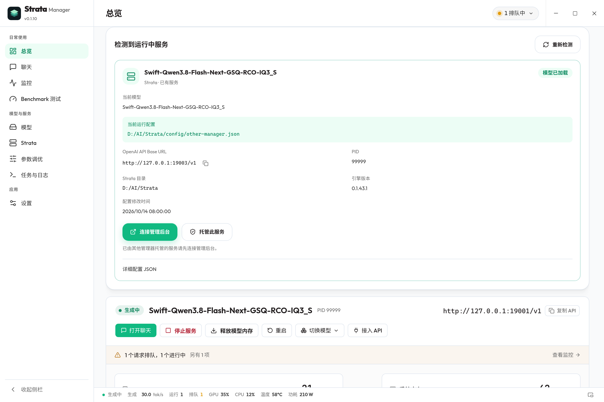
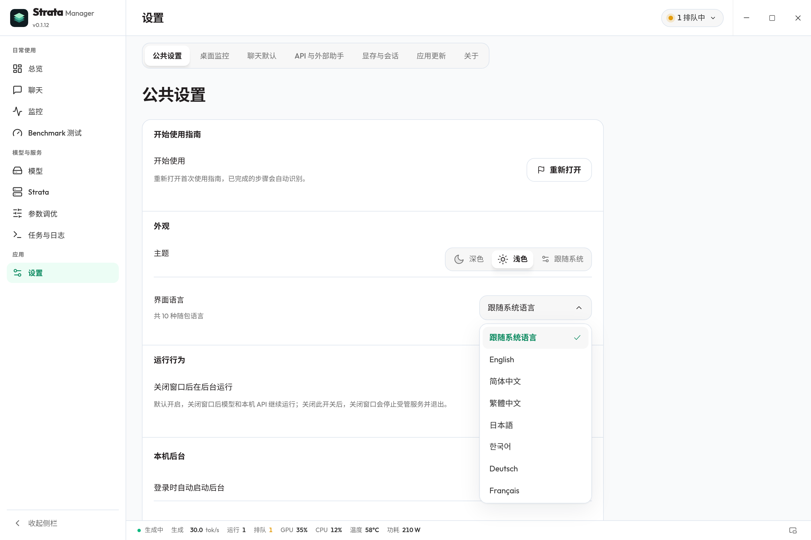
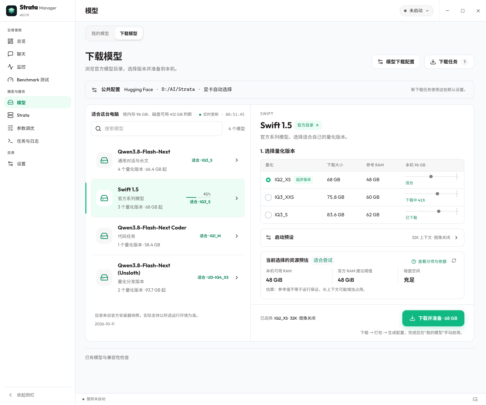
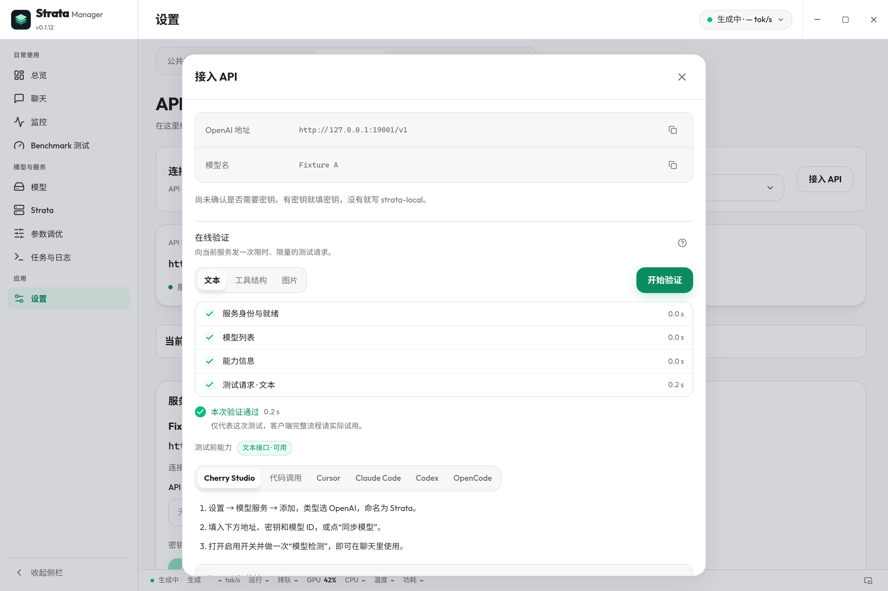
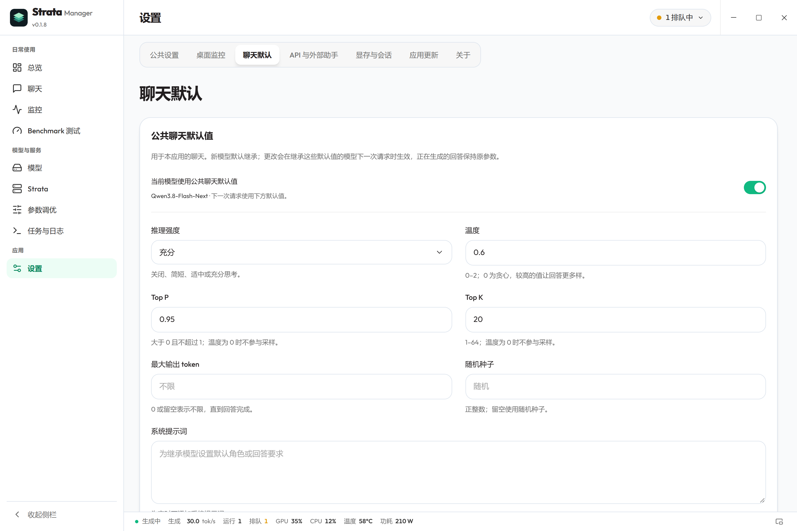
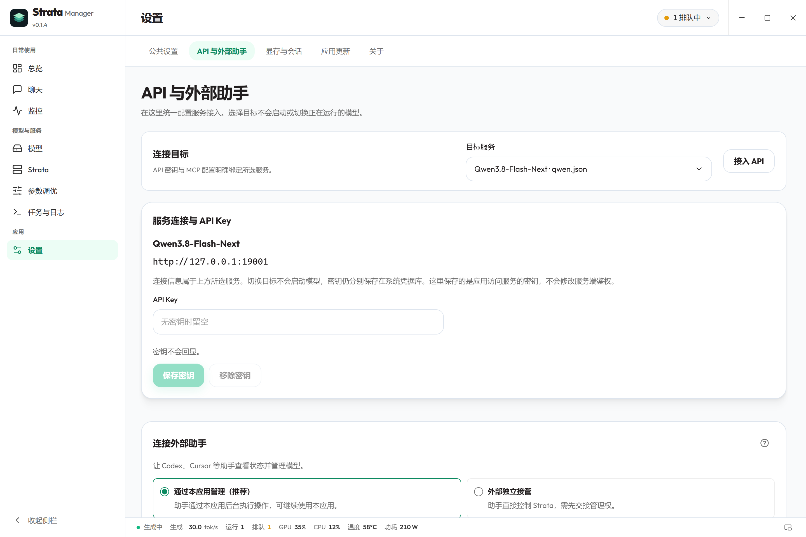
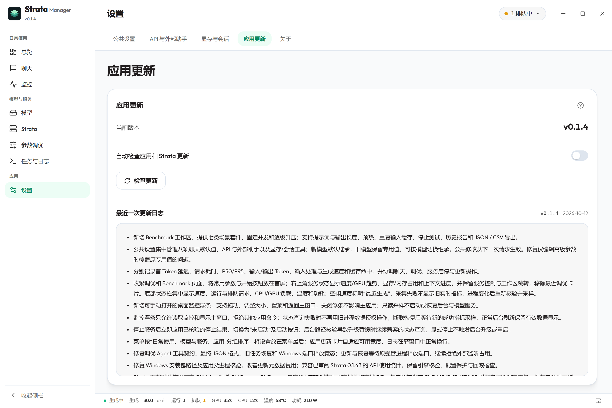
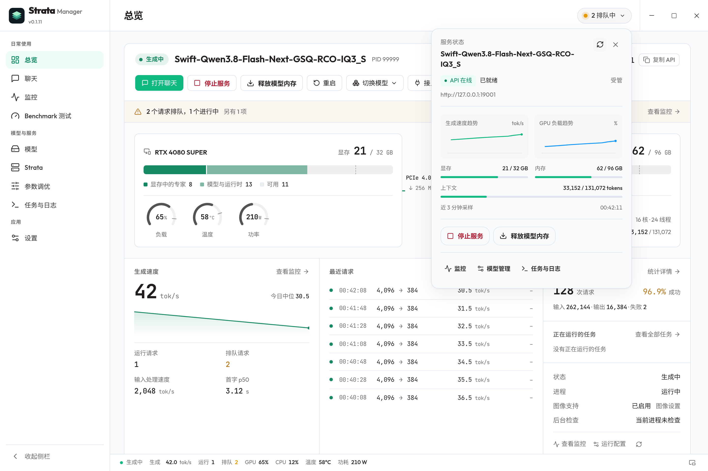
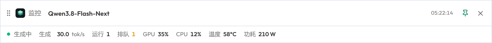
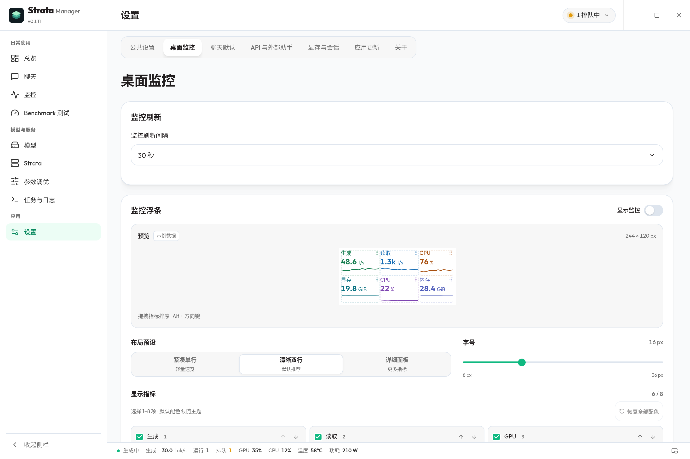

<div align="center">


<h1>Strata Manager</h1>
<p><strong>面向 Strata 本地推理的桌面工作台。</strong><br />准备运行环境，管理模型与服务，掌握本机 API 的运行情况。</p>

<p>
<a href="https://hongfaqiu.github.io/strata-manager/"><strong>官网</strong></a> ·
<a href="https://hongfaqiu.github.io/strata-manager/docs/index.html"><strong>文档中心</strong></a> ·
<a href="docs/SYSTEM.md">系统说明</a> ·
<a href="https://github.com/hongfaqiu/strata-manager/releases/latest"><strong>最新稳定版</strong></a> ·
<a href="CHANGELOG.md">更新日志</a> ·
<a href="README.md">English</a>
</p>

<p>
<a href="LICENSE"></a>


<a href="https://github.com/hongfaqiu/strata-manager/actions/workflows/ci.yml"></a>
</p>

</div>

**Strata Manager 是面向 [Niko1221/Strata 本地大模型推理引擎](https://github.com/Niko1221/Strata) 的开源桌面管理工具。** 将运行环境准备、模型配置、服务控制、聊天、监控、调优与基准测试集中到同一工作台，降低 Strata 的使用门槛。已有受支持的模型权重保持原位。

[](https://raw.githubusercontent.com/hongfaqiu/strata-manager/main/docs/screenshots/product-cover.zh.webp)

<sub>0.1.9 发布候选界面，2026 年 10 月 14 日重新采集，尚待公开发布。首页封面为完整总览，右上角服务状态保持收起。截图由实际应用与组件配合隔离示例数据渲染；显示数值不代表推理结果或性能测试。点击可查看原图。</sub>

## Strata 是什么，Manager 负责什么？

[Strata](https://github.com/Niko1221/Strata) 是开源的本地大模型（LLM）推理引擎，协调 GPU 显存、RAM 和 CPU 资源运行它支持的模型，并提供浏览器界面与本机 API。

| 组成 | 职责 |
| --- | --- |
| **Strata 运行时** | 加载模型、执行推理并提供 API。模型支持、图像输入与协议取决于已安装引擎和所选模型。 |
| **Strata Manager** | 准备与检查运行环境，管理本机模型和配置，控制服务，并提供聊天、监控、调优与基准测试工具。 |
| **你的应用** | 连接已启动的本机 API，调用模型能力。 |

Manager 是独立社区项目，管理的是**这台电脑**上受支持的 Strata 环境。运行时与模型权重独立安装。

## 从安装准备到日常使用

以下概览覆盖当前源码，稳定安装包的功能以对应发布说明为准。依赖引擎的工具会按已安装运行时的能力提供。

| 工作流程 | 可以完成的操作 |
| --- | --- |
| **1 · 准备 Strata** | 检测已有安装，查看本机与上游版本、官方更新日志。Windows x64 引擎 ZIP 默认使用官方 GitHub，支持 GH Proxy/GHProxy、自定义 HTTPS 或本地 ZIP，各来源按当前 CUDA12、CUDA13 或 HIP 引擎匹配；中断后保留部分文件并尝试 HTTP Range 续传，完整包仍按官方大小与 SHA256 校验。Linux 支持环境扫描、版本和日志查看。 |
| **2 · 整理模型** | 发现本机权重，按模型归并运行配置，选择下载来源与显卡，检查模型文件、GGUF 元数据和磁盘占用；支持 Swift IQ3_S 格式。 |
| **3 · 配置与运行** | 通过图形控件或 JSON 编辑配置，校验并保留备份；启动、停止、重启或释放模型内存，查看启动阶段、任务和日志。在 Windows 检查检测到的运行中服务、模型加载状态、API 地址与配置，连接已有管理后台或托管服务。打开应用或登录时仅启动轻量后台，保留服务停止状态。 |
| **4 · 聊天与接入** | 使用流式会话、附件与结构化输出。新模型默认继承公共生成参数与 MCP 开关，旧模型的专用值保持独立，主动开启继承后才跟随；更改在下一次聊天请求生效。在“API 与外部助手”集中配置连接目标、应用访问密钥、API 示例与 MCP，选择目标不会启动或切换模型。 |
| **5 · 查看会话与负载** | 保存和恢复引擎会话，查看槽位、负载、硬件及受支持的显存调整。状态面板区分近期生成与输入处理趋势，保留采样缺失点，显示空闲释放后自动载入模型的进度。桌面浮条默认关闭，提供三种布局、指标排序与字号配色设置，右键提供导航、置顶和采样等操作；可选系统托盘监控。只读观察不会启动或恢复服务，快速测速会发送推理请求。 |
| **6 · 分析用量与调优** | 保留本机 API 元数据，兼容 Strata 0.1.44 的 API 使用统计，查看请求、tokens、延迟和缓存复用趋势；按聊天、编程/Agent 或长文任务比较受支持的调优候选，再决定应用或恢复，不保证固定提速。 |
| **7 · 基准测试** | 串行运行核验过的上下文档位或七类场景，分别记录 Token 数、输入处理与生成速度、首 Token 延迟和资源采样；支持历史报告、JSON/CSV 导出、复制图表和 PNG 导出，并协调其它推理操作。 |
| **8 · 更新与偏好** | 分别管理应用、Strata 更新和模型权重；独立应用更新页提供随包双语日志的离线阅读、稳定更新检查和安装确认，使用 Tauri 签名校验。界面语言可跟随系统或选择十种随包语言；支持跟随系统/亮色/暗色外观和托盘控制。部分高级工具和原始服务日志使用英文。 |

API 使用统计无需捕获请求正文。可选的临时正文诊断是独立功能，行为与隐私说明见[使用指南](docs/USER_GUIDE.md)。

组件关系和数据保存见[系统说明](docs/SYSTEM.md)，各版本变更见 [CHANGELOG.md](CHANGELOG.md) 或[官网更新日志](https://hongfaqiu.github.io/strata-manager/docs/changelog.html)。

## 0.1.9 发布候选

**0.1.9 目前为发布候选，尚待公开发布**，包含以下改进。安装包是否可用以[发布页](https://github.com/hongfaqiu/strata-manager/releases/latest)为准；安装包验收与界面示例分开记录。

- **多卡选择与校准入口。** 模型下载设置支持勾选显卡编号；官方 `--calibrate` 仅生成终端命令，不在应用内执行。API 接入向导增加 Cursor / Codex；启动设置提供 batch / parallel 等常用项快捷表单。观察器兼容 Strata 0.1.44.1，并对更新的上游版本做结构检测（契约变化时自动降级为公开接口监控），多数上游新版无需等本应用适配；运行环境页可直接调用官方 `update.sh` / `UPDATE.bat`。
- **Windows 运行中服务集中管理。** 查看实际加载状态、当前模型、运行配置、PID、引擎版本和 OpenAI API Base URL。已有 Manager 后台的服务优先连接；托管普通外部服务可能重新加载模型。自动连接只在当前后台没有活动服务且发现唯一明确的运行候选时尝试；自动托管还要求模型健康、已加载且空闲，多候选保留手动选择。
- **跟随系统与随包语言资源。** 首次启动可确认语言，提供英语、简体／繁体中文、日语、韩语、德语、法语、西班牙语、葡萄牙语和俄语，也可跟随系统。语言包随应用提供，已有手动选择会保留；部分高级工具和原始日志仍使用英文。
- **可自定义的桌面监控。** 用开关显示或隐藏，默认清晰双行，也可选择紧凑单行或详细面板；支持 8–36px 字号、从 11 项指标中选择 1–8 项并排序。标签默认开启，状态文字与贴边吸附默认关闭；可切换单位、采样时间、折线，并逐项配色或恢复主题默认色。浮条可拖动，按指标稳定列宽，减少空白；读取默认蓝色、生成默认绿色，空闲历史速度不续画为实时曲线。设置文案精简，开关详情通过提示查看。常驻任务栏切换已移除，旧偏好迁回浮动条。
- **更清楚的载入与控件状态。** 空闲释放模型后，再次请求自动载入时，状态栏显示载入进度和实际耗时；工作区 Tab 恢复圆角分段样式，选择控件移除外层光晕。

| 检测到的运行中服务 | 跟随系统与语言包 |
| --- | --- |
| [](docs/screenshots/running-services.zh.webp) | [](docs/screenshots/language-settings.zh.webp) |

配图仍为 2026 年 10 月 14 日图库，覆盖 0.1.9 候选源码，来源见[截图记录](docs/screenshots/README.md)。原生窗口、真实 GPU 容量、长时稳定性与跨设备局域网的验收范围见[验证记录](docs/VERIFICATION.md)。

## 下载与开始使用

### 0.1.7 引入的日常工作流程

[0.1.7 发布版](https://github.com/hongfaqiu/strata-manager/releases/tag/v0.1.7)增加模型下载列表与详情、统一显卡及运行选项、按选择变化的资源评估、启动失败诊断、服务能力四态、聊天请求计时、API 在线验证与历史 Benchmark 条件比较。保存设置不会证明当前引擎已生效；缺少证据显示“未核验”，需要重启的选项单独提示。模型未就绪时不会自动启动在线验证。

这些工作流程在 0.1.9 中继续提供，详见[日常体验说明](docs/DAILY_EXPERIENCE.md)与[验收记录](docs/VERIFICATION.md)。下图已用当前组件和隔离示例数据重新采集，不代表 0.1.9 候选安装包或真实推理验收。

| 模型下载与资源选择 | API 验证与能力 |
| --- | --- |
| [](docs/screenshots/daily-experience/model-download-detail.zh.webp) | [](docs/screenshots/daily-experience/api-verification.zh.webp) |

### 稳定安装包

从[最新稳定发布页](https://github.com/hongfaqiu/strata-manager/releases/latest)或[官网下载区](https://hongfaqiu.github.io/strata-manager/#get-started)选择安装包。仅安装所选版本实际提供的文件，并用同一发布页的 `SHA256SUMS` 核对。

| 平台 | 安装形式 | 准备事项 |
| --- | --- | --- |
| **Windows x64** | NSIS 安装包（`.exe`） | 需要 WebView2；[Windows 安装说明](docs/DOWNLOAD.md#windows-安装)。 |
| **Linux x64** | AppImage 或 DEB | Ubuntu 22.04 CI 环境构建；[Linux 安装与支持范围](docs/DOWNLOAD.md#linux-安装)。 |

1. **准备运行环境。** 打开 Strata 页面检查已有安装，或按引导准备；已有受支持环境无需重装。
2. **选择模型与配置。** “我的模型”列出发现的权重，按需添加搜索目录，选择运行配置或下载新权重。
3. **点击“使用”。** 跟踪环境检查与加载，等待“模型可用”后开始聊天，或将本机 API 地址复制到其它应用。

桌面安装包包含 Manager 与独立后台。硬件和驱动要求取决于 Strata 与模型，macOS 和 ARM 尚不在发布目标中。安装步骤及包的支持范围见[下载说明](docs/DOWNLOAD.md)，日常操作见[使用指南](docs/USER_GUIDE.md)。

## 界面一览

以下图片使用当前应用与组件和隔离文档示例数据，均为亮色主题。点击图片可查看高清原图。

| 模型与运行配置 | 硬件与推理监控 |
| --- | --- |
| [](https://raw.githubusercontent.com/hongfaqiu/strata-manager/main/docs/screenshots/models.zh.webp) | [](https://raw.githubusercontent.com/hongfaqiu/strata-manager/main/docs/screenshots/monitor.zh.webp) |

<details>
<summary><strong>更多界面：运行环境、聊天、公共设置、连接、更新、基准测试与监控</strong></summary>

**Strata · 运行环境版本与更新**

[](https://raw.githubusercontent.com/hongfaqiu/strata-manager/main/docs/screenshots/runtime.zh.webp)

**运行配置 · 图形控件与 JSON**

[](https://raw.githubusercontent.com/hongfaqiu/strata-manager/main/docs/screenshots/config.zh.webp)

**API 用量 · 请求、Tokens 与缓存趋势**

[](https://raw.githubusercontent.com/hongfaqiu/strata-manager/main/docs/screenshots/usage.zh.webp)

**聊天 · 会话、流式内容与附件**

[](https://raw.githubusercontent.com/hongfaqiu/strata-manager/main/docs/screenshots/chat.zh.webp)

**调优 · 比较任务与参数候选**

[](https://raw.githubusercontent.com/hongfaqiu/strata-manager/main/docs/screenshots/tuning.zh.webp)

**基准测试 · 上下文档位与历史条件**

[](https://raw.githubusercontent.com/hongfaqiu/strata-manager/main/docs/screenshots/benchmark.zh.webp)

[](docs/screenshots/daily-experience/history-comparison.zh.webp)

**设置与关于**

[](https://raw.githubusercontent.com/hongfaqiu/strata-manager/main/docs/screenshots/settings.zh.webp)

[](https://raw.githubusercontent.com/hongfaqiu/strata-manager/main/docs/screenshots/about.zh.webp)

**公共聊天默认值 · 按模型选择继承**

[](https://raw.githubusercontent.com/hongfaqiu/strata-manager/main/docs/screenshots/common-chat-settings.zh.webp)

**连接 · API 与外部助手**

[](https://raw.githubusercontent.com/hongfaqiu/strata-manager/main/docs/screenshots/connections.zh.webp)

**应用更新 · 双语日志与安装确认**

[](https://raw.githubusercontent.com/hongfaqiu/strata-manager/main/docs/screenshots/app-updates.zh.webp)

**服务状态 · 近期生成与输入处理趋势**

[](https://raw.githubusercontent.com/hongfaqiu/strata-manager/main/docs/screenshots/service-status.zh.webp)

**独立桌面监控浮条 · 默认关闭**

[](https://raw.githubusercontent.com/hongfaqiu/strata-manager/main/docs/screenshots/floating-monitor.zh.webp)

[](docs/screenshots/floating-monitor-settings.zh.webp)

</details>

## 常见问题

**关闭窗口，API 会停止吗？** 默认关闭到托盘，已启动服务继续运行。关闭此选项后会停止受管服务并退出，也可直接使用托盘的“停止服务并退出”。

**释放模型内存会删掉模型吗？** 不会。它释放内存和显存，保留模型文件与 API 进程；移除保存的配置也保留原权重。

**所有操作都离线吗？** 聊天与用量记录保存在本机。下载和更新需要网络，配置的 MCP 工具可能访问外部服务；启用前检查工具行为，分享诊断前移除私密内容。

API 接入、诊断与调优限制见[使用指南](docs/USER_GUIDE.md)。发现问题可通过 [Issues](https://github.com/hongfaqiu/strata-manager/issues) 反馈。

<details>
<summary><strong>从源码构建</strong></summary>

需要 Node.js **22.13+**、pnpm **11.21.0** 和 Rust stable。Windows 还需要 MSVC C++ Build Tools、Windows SDK 与 WebView2；Linux 前置依赖见 [Tauri 文档](https://v2.tauri.app/start/prerequisites/)。

```sh
git clone https://github.com/hongfaqiu/strata-manager.git
cd strata-manager
pnpm install --frozen-lockfile
pnpm desktop
```

维护资料见[开发说明](docs/DEVELOPMENT.md)、[发布说明](docs/RELEASING.md)和[验证记录](docs/VERIFICATION.md)。

</details>

## 致谢与许可

感谢 [Niko1221/Strata](https://github.com/Niko1221/Strata) 的作者与贡献者。Strata Manager 是独立社区桌面应用。

本仓库采用 [MIT](LICENSE)，复用资源保留上游声明，Outfit 字体使用 SIL OFL 1.1；详见[第三方声明](THIRD_PARTY_NOTICES.md)。模型权重保留提供方的许可。
