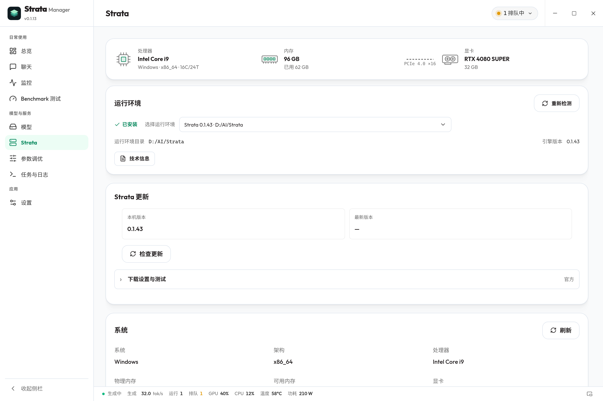
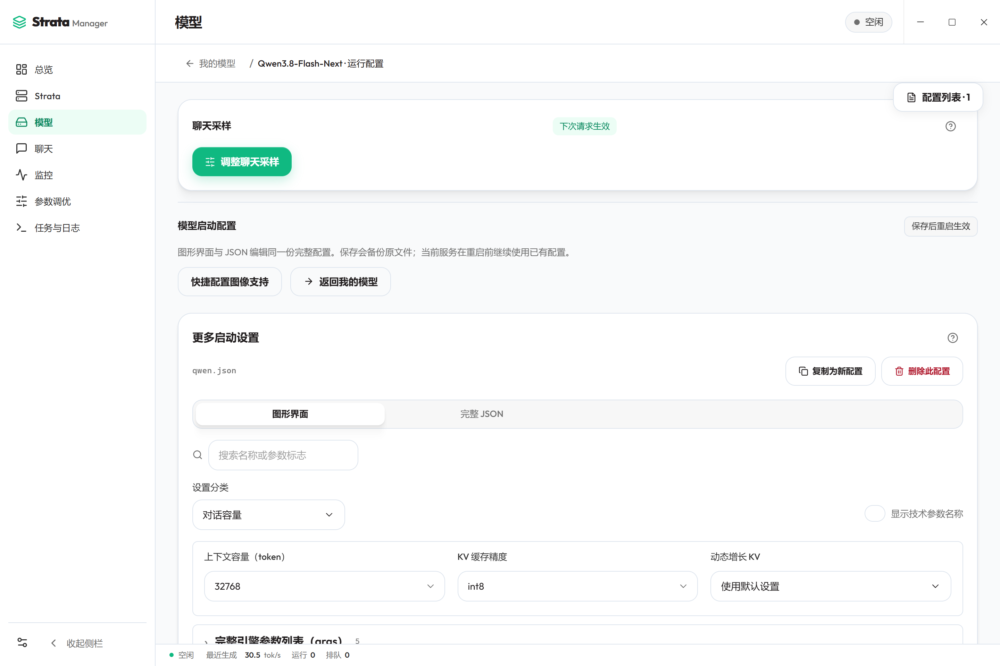
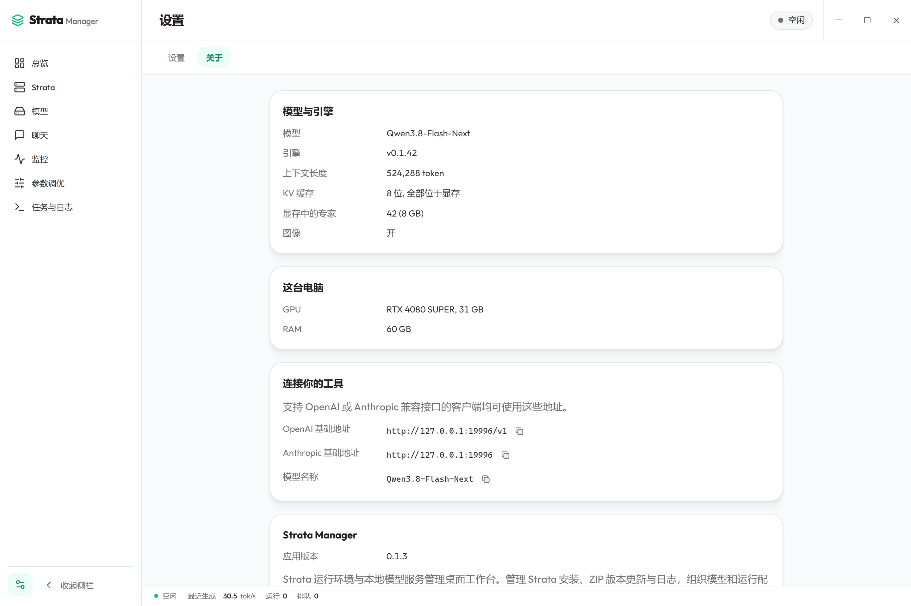

<div align="center">

<a href="https://raw.githubusercontent.com/hongfaqiu/strata-manager/main/docs/screenshots/product-cover.webp"></a>

<h1>Strata Manager</h1>

<p><strong>Strata 运行环境与本地模型服务管理桌面工作台。</strong><br>
安装和更新 Strata，选择模型运行配置，管理本机 API。</p>

<p>
<a href="LICENSE"></a>


<a href="https://github.com/hongfaqiu/strata-manager/actions/workflows/ci.yml"></a>
</p>

<p>
<a href="https://hongfaqiu.github.io/strata-manager/?lang=zh">官网</a> ·
<a href="README.md">English</a> ·
<a href="#下载与体验">下载与体验</a> ·
<a href="#三步开始使用">快速上手</a> ·
<a href="#看看它的样子">界面展示</a> ·
<a href="https://hongfaqiu.github.io/strata-manager/docs/user-guide.html">使用指南</a> ·
<a href="https://hongfaqiu.github.io/strata-manager/docs/index.html">文档目录</a>
</p>

</div>

Strata Manager 是开源的 [Strata](https://github.com/Niko1221/Strata) 运行环境与本地模型服务管理桌面工作台。核心是运行环境安装和更新、模型运行配置，以及服务启动、停止与恢复；聊天、监控、API 使用统计和参数调优为这些流程提供配套工具。已有权重保持原位，已启动的服务由独立后台管理。

下方功能与截图描述 0.1.1 源码。安装包是否已公开及对应版本，以[发布页](https://github.com/hongfaqiu/strata-manager/releases/tag/v0.1.1)为准。发布检查按 revision 独立执行，本文不将未发布候选视为已经通过验收。

## 什么是 Strata？

[Strata](https://github.com/Niko1221/Strata) 是开源的本地推理项目，协调 GPU 显存、RAM 和 CPU 资源运行它支持的模型，并提供浏览器界面与本机 API。

Strata Manager 是独立社区项目，并非 Strata 官方应用，负责管理这台电脑上的 Strata；具体推理能力、支持的模型、图像输入与 API 协议由已安装的 Strata 运行时和模型提供。

> **v0.1.1 发布入口。** 下载前检查发布页实际提供的安装包，版本说明见[发布页](https://github.com/hongfaqiu/strata-manager/releases/tag/v0.1.1)，安装步骤见[下载说明](https://hongfaqiu.github.io/strata-manager/docs/download.html)。

## 为什么使用 Strata Manager

- **全局管理 Strata。** 在独立 Strata 页面检测或准备运行环境，查看本机版本、上游版本与官方更新日志；匹配的官方 Windows x64 引擎 ZIP 支持下载、解包与更新进度，Linux 暂无 ZIP 引擎更新。运行环境不再按模型重复管理。
- **先看更新，再确认安装。** 默认在打开应用及每 12 小时自动检查；发现更新后展示日志，由你确认安装。应用、Strata 与模型权重分别管理。
- **直接看到已有模型。** “我的模型”自动展示发现的本机模型，同一模型下汇总运行配置；支持切换配置、查看修改日期、标记当前与上次使用的配置，原权重无需重复下载。
- **完整编辑运行配置。** 从模型内打开二级配置页，通过带建议值和自定义输入的图形化控件或 JSON 编辑配置；保存前校验并保留备份。
- **控制本机服务。** 启动、停止、重启或释放模型内存，查看启动阶段与日志；浏览其它配置时，当前活跃模型和配置仍清楚可见。释放内存保留模型文件。
- **查看运行与用量。** 监控服务和硬件，使用统计在重新打开应用后保留，并通过图表显示请求、tokens、延迟、缓存率、prefill 和解码速度；缺失测量保持未知。
- **在同一工作台聊天。** 多会话、流式回答与附件集中展示；思考过程、图像输入和 MCP 工具事件依赖运行时与模型支持。
- **用完整任务调优。** 按日常聊天、编程与 Agent、长文分析测量，比较 PCIe/MTP 请求参数及受支持的 CPU、异步换入、prefill 和显存预留重启候选，通过质量与资源检查后再应用或恢复；不是所有配置的自动搜索，也不保证固定提速。

合并后的窗口顶部栏随应用主题变化，默认外观跟随系统。语言和主题放在设置中，设置入口位于侧栏左下角。关闭窗口后台运行默认开启；关闭该选项后，关闭窗口会询问并停止受管服务退出，可选择不再提示。托盘支持查看服务状态和快捷操作。

## 三步开始使用

1. **先准备 Strata。** 打开 Strata 页面查看检测到的运行环境和版本。已有环境无需重装；没有环境时，先完成安装引导，再选择或下载模型。
2. **选择模型与运行配置。** “我的模型”直接列出发现的模型；选中配置，检测遗漏时添加搜索目录。需要新权重时进入“下载模型”，需要改参数时打开模型内的“运行配置”。
3. **点击“使用”，跟踪启动。** 模型加入受管列表并显示环境检查、启动和加载进度。等待“模型可用”后开始聊天，或将本机 API 地址复制到其它应用；当前模型和配置会在列表中标记。

已有模型保持原位，应用使用受管配置副本。首次下载新模型可能需要较长时间，进度与失败原因会显示在任务中。遇到问题可查看[第一次使用指南](docs/USER_GUIDE.md#第一次使用)。

## 下载与体验

通过 **v0.1.1** 发布入口选择对应系统的安装包，仅安装发布页实际提供的文件；完整步骤见[下载与体验说明](https://hongfaqiu.github.io/strata-manager/docs/download.html)。

| 平台 | 安装形式 | 当前体验方式 |
| --- | --- | --- |
| Windows x64 | [NSIS 安装包](https://github.com/hongfaqiu/strata-manager/releases/download/v0.1.1/Strata.Manager_0.1.1_x64-setup.exe) | 需要 WebView2；[安装说明](https://hongfaqiu.github.io/strata-manager/docs/download.html#windows-安装)。 |
| Linux x64 | [AppImage](https://github.com/hongfaqiu/strata-manager/releases/download/v0.1.1/Strata.Manager_0.1.1_amd64.AppImage) / [DEB](https://github.com/hongfaqiu/strata-manager/releases/download/v0.1.1/Strata.Manager_0.1.1_amd64.deb) | Ubuntu 22.04 CI 环境构建；[安装与支持范围](https://hongfaqiu.github.io/strata-manager/docs/download.html#linux-安装)。 |

[SHA256 校验文件](https://github.com/hongfaqiu/strata-manager/releases/download/v0.1.1/SHA256SUMS) · [版本说明](https://github.com/hongfaqiu/strata-manager/releases/tag/v0.1.1)

CI 门禁覆盖 Windows 静默安装、桌面启动、私有后台 IPC、关闭和卸载，以及 Ubuntu 22.04 Xvfb 下的 Linux AppImage/解包 DEB 启动、私有 IPC 和关闭。已完成流水线对应的 revision 见[验证记录](https://github.com/hongfaqiu/strata-manager/blob/main/docs/VERIFICATION.md)。系统 DEB 安装、真实 GPU 与登录自启动仍需独立验收；跨版本 NSIS 安装器检查不能代替 Tauri 自动更新下载、验签与安装的端到端验收。

安装包包含桌面应用和后台，Strata 运行环境与模型权重独立准备。稳定版使用 `latest` 更新通道，预览版保留手工下载且不替换该通道；Tauri 更新签名与 Windows 发布者签名不同。硬件、显存、内存与驱动要求请按所选模型查看 [Strata 说明](https://github.com/Niko1221/Strata)。

<details>
<summary><strong>从源码体验</strong></summary>

需要 Node.js 22.13+、项目固定的 pnpm 11 和 Rust stable。Windows 还需要 MSVC、Windows SDK 与 WebView2；Linux 前置依赖见 [Tauri 文档](https://v2.tauri.app/start/prerequisites/)。

```sh
git clone https://github.com/hongfaqiu/strata-manager.git
cd strata-manager
pnpm install --frozen-lockfile
pnpm desktop
```

维护者的开发、测试和打包资料保留在 GitHub 的[开发说明源码](https://github.com/hongfaqiu/strata-manager/blob/main/docs/DEVELOPMENT.md)。

</details>

## 看看它的样子

截图由当前应用组件使用隔离的示例数据渲染。模型状态、聊天、用量与调优数值均为示例，不代表真实推理结果或性能测量；封面展示 Strata 管理页。点击图片可查看高清原图。

### Strata，全局管理运行环境

查看本机与上游版本、官方更新日志，确认后跟踪匹配的 Windows x64 ZIP 更新任务。

[](https://raw.githubusercontent.com/hongfaqiu/strata-manager/main/docs/screenshots/runtime.zh.webp)

### 我的模型，直接展示已有模型

模型按权重汇总运行配置，当前活跃模型和配置使用卡片显示。

[](https://raw.githubusercontent.com/hongfaqiu/strata-manager/main/docs/screenshots/models.zh.webp)

### 运行配置，图形化与 JSON 一起编辑

在模型内部打开配置页，查看完整参数并保存备份。

[](https://raw.githubusercontent.com/hongfaqiu/strata-manager/main/docs/screenshots/config.zh.webp)

### API 用量，看见日常使用

查看请求、tokens、延迟、缓存率、prefill 和解码速度的趋势。

[](https://raw.githubusercontent.com/hongfaqiu/strata-manager/main/docs/screenshots/usage.zh.webp)

### 参数调优，让选择有依据

按实际用途比较完整任务和受支持候选，检查质量、资源与基线漂移，再决定是否应用。没有稳定收益时保留当前设置。

[](https://raw.githubusercontent.com/hongfaqiu/strata-manager/main/docs/screenshots/tuning.zh.webp)

<details>
<summary><strong>更多界面：总览、监控、聊天、设置与关于</strong></summary>

<br>

[](https://raw.githubusercontent.com/hongfaqiu/strata-manager/main/docs/screenshots/overview.zh.webp)

[](https://raw.githubusercontent.com/hongfaqiu/strata-manager/main/docs/screenshots/monitor.zh.webp)

[](https://raw.githubusercontent.com/hongfaqiu/strata-manager/main/docs/screenshots/chat.zh.webp)

[](https://raw.githubusercontent.com/hongfaqiu/strata-manager/main/docs/screenshots/settings.zh.webp)

[](https://raw.githubusercontent.com/hongfaqiu/strata-manager/main/docs/screenshots/about.zh.webp)

</details>

## 常见问题

**我已经有模型，为什么还要下载？** “我的模型”直接显示发现的模型；检测遗漏时添加搜索目录。受支持的已有 Strata 模型无需重新下载权重，只有准备新模型时才下载。

**关掉窗口，API 会停止吗？** “关闭窗口后在后台运行”默认开启，已启动服务会继续运行。关闭该选项后，关闭窗口会询问并停止受管服务退出，可勾选不再提示；也可直接使用托盘中的“停止服务并退出”。

**释放模型内存会删掉模型吗？** 不会，它释放内存和显存，保留模型文件与 API 进程；移除保存的配置也不会删除原模型文件。

**API 使用统计和请求查看器是同一个功能吗？** 不是。使用统计保存本机元数据并绘制趋势；兼容且通过身份核验的受管运行时，可在高级诊断中开启 5、15 或 30 分钟临时正文捕获，最多在 RAM 保留最近 100 条请求，主动关闭捕获或到期清空正文，不修改 `api_monitor`。原配置已开启的查看器仍由你单独管理。用量统计不需要开启正文诊断。

**聊天和统计会上传吗？** 聊天记录保存在本机，使用统计只保存元数据。模型下载和更新需要网络；MCP 工具按你的配置运行，可能访问外部服务或发送数据，启用前请检查工具的行为。请求正文诊断与用量统计是两个独立功能，详见[数据与隐私](docs/USER_GUIDE.md#数据与隐私)。

**调优一定会更快吗？** 收益取决于模型、硬件与任务。应用在所选完整用途场景中比较请求参数和受支持的重启候选，通过质量、资源与重复收益检查后才推荐；不是自动搜索所有配置。没有稳定收益时保留当前配置，截图数值不代表实测提速。

更多安装、API 接入、用量、调优和更新说明见[使用指南](docs/USER_GUIDE.md)。发现问题可在 [Issues](https://github.com/hongfaqiu/strata-manager/issues) 反馈，请移除密钥和个人聊天内容。

## 致谢与许可

感谢 [Niko1221/Strata](https://github.com/Niko1221/Strata) 的作者与贡献者。本项目复用 Strata 的官方前端设计和功能，是独立社区桌面应用；Strata 推理运行时与模型权重独立安装，模型许可由提供方规定。

本仓库采用 [MIT](LICENSE)。复用代码与界面保留上游版权声明，Outfit 字体使用 SIL OFL 1.1；详见[第三方声明](THIRD_PARTY_NOTICES.md)。

<p align="center"><sub><a href="https://hongfaqiu.github.io/strata-manager/?lang=zh">Strata Manager 官网</a> · Strata 运行环境与本地模型服务管理桌面工作台。</sub></p>
