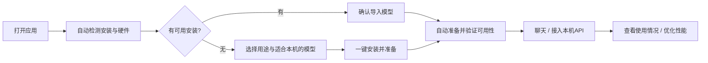
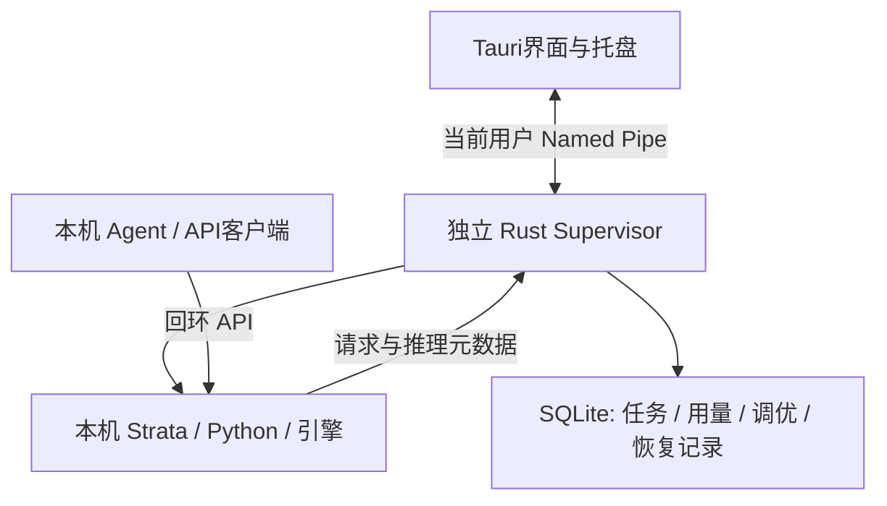

# Strata Manager 生产化改造方案

日期：2026-10-10。状态：研究与实施设计，尚未实现下述生产架构。当前仓库是功能原型，既有协议和真实模型验证不能替代后台生命周期、升级与长期稳定性验收。

## 产品边界与用户流程

定位为**安装好就能使用的本机 Strata 工作台**。普通用户选模型、聊天；开发用户把本机 API 接入 Agent，再看用量并优化性能。

已确认：只管理本应用安装或导入的本机 Strata，支持导入已有安装，模型文件保持原位。移除远程节点、任意服务 URL、服务档案以及“由应用管理进程”开关。地址、Python路径、进程归属和加载顺序由后台维护。支持登录自启动、后台运行、自动更新、检测与恢复、API使用监控、场景调优。保留官方 Chat/Monitor/About/Sampling/API Monitor 的内容能力、中英国际化和自绘控件，外层按桌面软件重组。

其他本机应用仍可调用本机 API；调用客户端不等于远程服务管理。本版不提供远程节点入口或对外网开放监听。

用户只经历“选择 → 准备 → 使用”。Python、依赖、引擎、权重、配置、启动与加载组成一个后台任务，失败定位到可重试的子阶段。模型选择前说明下载量、可用磁盘与资源需求的来源；估计需求不能写成本机运行保证。

检测已登记目录、应用默认目录、可识别的本机启动进程及配置，不遍历所有磁盘或扫描所有端口。识别不到时只让用户选择 Strata 目录，自动查找 Python、配置和模型。多个候选以模型、版本和目录区分。

正在运行的既有实例先只读识别。一次性导入迁移核验 PID创建时间、完整启动命令、监听端口、venv、配置及活动请求；空闲后再切换归属。无法核验不停止，给出明确迁移步骤。导入后不再出现日常 managed 开关；原仓库、启动脚本和配置保留。

默认后台启动轻量 API，首次使用自动加载已选模型。聊天提前加载并展示真实进度；接入 Agent 时自动预热，提供“始终就绪”策略，避免首次大模型加载超过客户端超时。空闲释放模型仍保留 API，下一次使用自动恢复。只保留一个默认 GPU 模型，切换等待活动请求结束。

## 架构与技术栈

保持 Tauri 2 + React + TypeScript + Vite + pnpm workspace；原生采用 Rust workspace、Tokio、reqwest、SQLite。为了桌面体验无需换框架。

| 位置 | 职责 |
|---|---|
| `apps/desktop` | 窗口、托盘、桌面交互；Tauri Rust层作为后台RPC客户端 |
| `apps/supervisor` | 服务归属、健康、下载、模型加载、更新、采集与调优任务 |
| `crates/runtime-core` | 从现有原生代码提取进程、配置、安装及诊断逻辑 |
| `crates/local-ipc` | 版本化请求/事件协议、用户ACL、大小与超时约束 |
| `packages/core` | 前端类型、API/SSE适配、指标口径、能力描述与协议测试 |
| `packages/ui` | 官方设计令牌、自绘控件、桌面容器与国际化 |
| `runtime/observer` | 固定上游版本的元数据观测适配及兼容测试 |

后台持有 Strata 的 Windows Job Object，UI 不拥有模型进程。采用每用户后台，不默认安装系统 Windows Service。Named Pipe 限制当前用户/登录会话，不能依赖默认ACL；互斥锁保证后台与模型不重复启动。

业务实体改为 `LocalInstallation`、`ModelAsset`、`RunPlan`、`RuntimeSession`、`Task`、`BenchmarkRun`，替代 URL中心的 `ServiceProfile`。地址从本机登记生成；前后端同时拒绝远程地址。旧数据先备份，本机档案导入核验，远程档案只留迁移/导出记录，不自动连接。

状态区分：检测中、未安装、需要修复、API就绪、模型准备中、模型可用、正在响应/排队、空闲。更新和调优是互斥维护任务。状态含原因和下一步，不能仅凭端口监听显示“模型可用”。启动、加载及重试必须幂等。

| 场景 | 行为 |
|---|---|
| 关闭窗口 | 进入托盘，后台和API继续运行 |
| 退出界面、UI更新、WebView崩溃 | 后台继续运行，重开重新连接 |
| 退出并停止本地服务 | 等待请求完成，再卸载模型并停止后台；超时说明受影响任务 |
| 登录自启动 | 后台启动不弹主窗口；是否预加载由运行策略决定 |
| 模型异常 | 记录原因、有限退避重试；OOM/坏配置/循环崩溃进入修复状态 |
| Supervisor异常 | Job释放模型，重开或下次登录恢复；无人值守恢复另用每用户计划任务并验收 |
| 睡眠、唤醒、注销、关机 | 保存任务/统计，重验健康与设备，按恢复记录运行 |

登录自启动、后台崩溃恢复和模型崩溃恢复分别验收，不能仅安装 autostart 插件就声称全部实现。

## 安装与三级更新

检测CPU/GPU/内存、可用磁盘、驱动和所选版本要求。应用维护自己的Python/依赖环境，不以全局PATH、Git或用户手动安装Python为默认前提；驱动不兼容给出原因与官方解决入口。模型独立存储，支持原位导入、校验与继续下载。安装任务有中断日志和恢复点。

| 更新层 | 策略 |
|---|---|
| 桌面应用 | 自动检查/下载/验证签名，按设置在合适时机安装并恢复窗口 |
| Supervisor / Strata / Python / 引擎 | 固定兼容版本，新目录准备候选，空闲时切换，健康和短请求失败即恢复旧版本/配置 |
| 模型权重 | 独立缓存和校验；应用更新不重复下载或擅自替换大型权重 |

Supervisor 位于独立版本目录，不放在UI升级会覆盖的活动路径。UI/后台协议兼容滚动升级版本。运行时更新可能短暂停服，需等待活动请求、显示维护状态并可回滚；不承诺零中断。导入的用户仓库不执行原地自动 `git pull`，应用维护新运行时目录并保留原安装。

使用 Tauri updater 的签名清单和公钥校验；Windows安装包签名与updater签名分别配置。发布前需要真实更新端点、密钥管理、CI和可用回滚发行版，不能以占位URL宣称自动更新完成。离线或下载失败继续用当前版本。切换保存版本、配置hash、验收及恢复结果；数据库迁移有备份和版本策略。

## API监控：优先提供用户关心的数据

总览回答“能不能用、今天用了多少、为什么变慢、是否需要处理”，优先展示当前模型与状态、正在运行/排队请求、资源余量、今日API调用/错误/取消、输入输出token、首次响应P50/P95及样本量、最近调用来源。提示要有依据，例如首次加载耗时、内存余量不足；不默认显示虚构云服务节省费用或整机用电成本。

监控页分 **使用情况 / 性能与资源 / 请求明细 / 诊断日志**。保留官方图表、正文页签、计时和复制；默认不让用户先面对JSON。请求列表支持时间、客户端、模型、状态筛选，排序、键盘选择和CSV导出。

| 指标 | 口径 |
|---|---|
| API调用量 | 一次用户推理HTTP请求一次，健康/模型查询/采集不计；按endpoint分类 |
| 推理轮数/工具次数 | 单独计，MCP多轮不能重复计为API调用，工具耗时分开 |
| 成功/失败/取消 | HTTP状态与流终态共同判定；HTTP200不保证SSE完整成功 |
| 输入/输出/缓存token | API usage与推理run分开；Anthropic缓存输入补齐口径；缺失是未知，不按字符估算 |
| 首次响应 | 排队、加载、输入处理、首生成token、思考/正文/工具首段区分；首token不一定用户可见 |
| 输入/生成速度 | 用引擎计时；热输入按新增token算，不用总输入除以很短的热TTFT |
| 延迟分布 | 按模型、冷热加载和输入长度分组，说明样本量与采集覆盖 |
| 上下文与缓存 | 输入/输出预算、前缀复用、切换会话恢复分别显示；专家hit_rate和PCIe分派一起解释 |
| 资源 | 真实采样/峰值；系统总量与应用进程分开，不归因全部整机占用 |
| 调用方 | 明确客户端标签或认证来源；自报标签不当作认证，未知不猜应用名 |

官方 `/api/requests` 是HTTP级，默认关闭，打开会在内存保留最近100条含正文记录；`/metrics` 是推理run级，最多500条、默认响应12条，其累计包含错误/取消。两者重启清空，环形缓冲轮询不足以保证完整今日统计；Prometheus的success字段也不能仅据名称当成功HTTP次数。

由Supervisor持续采集，与页面开关无关。应用维护的固定版本runtime增加小范围、可测试的 **metadata-only观测扩展**：HTTP接收/鉴权/解析/结束、推理run与工具事件关联request_id/run_id/session_id/sequence，提供有界重放与持久化ACK。SQLite幂等去重，完成状态与聚合事务更新；断档、溢出、崩溃未结束请求显式标为不完整，不补零。

旧安装没有扩展时只显示“最近已观测/本次服务会话”，导入匹配runtime后才开完整历史。第一版不为统计增加HTTP代理；官方已有自动加载。将来确需多模型路由、独立客户端密钥/配额或统一网关时，才另验OpenAI Chat/Responses/Anthropic、SSE、取消、图像、MCP及长冷启动兼容。

建议表：`api_requests`、`inference_runs`、`tool_runs`、`usage_buckets`、`resource_samples`、`runtime_sessions`、`collector_gaps`。设计默认元数据30天、日聚合365天，另有容量上限/可调保留策略，实施时做容量压测。存UTC，界面按本机时区分“今日”，展示采集起点、缺失区间。

默认不持久化提示词、回答、思考、附件、工具参数或密钥。官方正文查看保留为临时诊断捕获，明确范围/开关/自动到期；正文持久化另外选择期限。默认无云端用量上报，导出脱敏。`api_monitor=true` 本身会捕获正文，不能当作默认的metadata-only统计。

## 场景调优

“优化性能”只要求选 **日常聊天 / 编程与Agent / 长文分析**。PCIe/MTP/KV等折叠到高级设置；回答偏好与硬件性能优化分开。

已读取引用线程“继续调优本地模型速度”，并核对当日原始报告。下列是特定机器、SC117 IQ3_S、Strata0.1.41的结果，不是通用最佳值：

| 实测 | 设计含义 |
|---|---|
| 官方短英文校准候选在512-token中英复验中，代码-23.2%、中文-44.3% | CLI只生成候选，不能直接一键应用winner |
| prefill16384→32768：128K冷TTFT40.122→37.952s，多占约6.05GiB RAM，32K稍慢 | 同时显示收益和内存代价，不默认增到最大 |
| 128K冷TTFT41.287s，同前缀立即重复0.205s | 冷/热/切换会话单独测，只证明当前live会话复用 |
| 近512K首轮watchdog退出，重试成功 | 容量通过不等于持续稳定通过，保留失败记录 |

自动任务：

1. 检查版本/硬件/配置/资源，等空闲进入维护；不启动第二个大模型。
2. 保存原配置字节/hash与已验证版本，建立恢复journal，先测基线。
3. 请求级PCIe/MTP有限交错筛选；worker/异步换入/prefill/显存reserve分阶段重启测。context/KV/RoPE归为容量与质量方案。
4. 按用途复验中文、完整可运行代码/确定性测试、工具参数及续答、视觉、长文检索；截断512token不代替完整Agent任务。
5. A基线→B候选→A恢复复测，记录缓存、换页与漂移；收益要超过本次波动并可重复，不套用固定3%阈值。
6. 冷输入、热前缀、切换会话、持续生成、完整Agent总耗时分别评分；上下文按需求逐档验证，不自动跑满。
7. 质量/资源/稳定性都通过才原子应用，显示收益/代价/样本量；没有可靠收益保留原配置。
8. 取消、崩溃、超时、OOM或候选失败恢复旧配置并健康/短请求检查，恢复失败显示修复步骤。

结果绑定CPU/GPU/驱动/RAM、引擎hash、模型量化、context/KV、配置hash、场景与基准版本；更新后标记待复验。官方calibrate原版只输出建议，不用 `setup --calibrate` 直接覆盖生产配置。进度基于实际阶段/候选数，时间估计来自当前机器已完成样本；引用的官方完整校准耗时1254秒，不能承诺几分钟必定优化。

## 桌面原生体验

Tauri内容仍由WebView渲染，桌面感靠系统窗口行为与一致交互落实。保留官方品牌、重点颜色、专业内容与自绘控件，改变外层密度和布局。

- 第一版保留系统标题栏、缩放及窗口管理，不重复画窗口按钮；下方紧凑页内工具栏只放当前标题/状态/操作。
- 主入口收敛为 **总览 / 模型 / 聊天 / 调优 / 监控 / 设置**。监控标签保留性能/API/请求/日志，设置容纳环境/更新/策略/关于，模型详情保留高级启停/配置/诊断。
- 菜单项使用各自独立图标；API鉴权等操作移入共享Header的actions，不另做重复Header。官方内容与控件逐项回归，不能因收敛导航丢失元素能力。
- 移除独立服务选择器，必要位置显示当前模型/用途方案；聊天历史继续在聊天页。
- 复用 `AppLayout → WorkspaceLayout → 页面`，共享工具栏、状态栏及任务中心，不在API页重复标题。
- 紧凑行式列表、列表/详情分栏、虚拟请求列表；减少大卡片、厚阴影和无信息留白。
- 桌面壳用系统字体，品牌/保留官方内容维护独立令牌，避免全局CSS破坏图表和官方元素。
- 自绘控件统一焦点/悬停/禁用/键盘规则，不用浏览器默认外观或alert/confirm。
- 底部收起按钮与动画保留，滚动条悬停或键盘聚焦出现，遵循减少动画偏好。
- 保存窗口位置/尺寸/分栏/当前页，多屏变化不丢窗口；验100/125/150/200%DPI、键盘和高对比度。
- 窗口内支持新对话、查找/命令、切页、Esc，避免覆盖文本编辑快捷键；通知仅任务完成/故障/需处理事件。
- 托盘提供打开/状态/资源策略/暂停恢复/退出并停止，不成为另一套复杂管理页。
- 初始空状态只显示检测/安装/导入下一步；未配置时不出现连接故障和一屏空指标。

## 实施顺序和生产门槛

| 阶段 | 交付 | 验收 |
|---|---|---|
| P0后台 | Rust workspace、Supervisor/IPC、实体迁移、自动检测/导入/启动加载 | UI关闭/崩溃不终止API，不重复启动；端口冲突不误杀；导入保留原文件；无需填路径即可聊天 |
| P1桌面与引导 | 六入口、共享工具栏/状态栏、安装任务、托盘/登录启动 | 干净机器第一条真实回复；缺驱动/断网/磁盘不足恢复；中英/DPI/键盘；登录不弹窗 |
| P2统计 | 观测适配、SQLite历史、概览/性能/明细 | 三种API、SSE结束/断流/取消/鉴权解析失败、MCP不重复；重启保留；断档说明；默认不存正文 |
| P3调优 | 场景基准、有限候选、A/B/A、原子应用/回滚与报告 | 基线可复现，无收益不变更；异常恢复；质量不退步；完整Agent与容量稳定性分开验 |
| P4发布 | 三级更新、签名链、数据库迁移、安装/卸载恢复 | UI活动请求期间升级；runtime坏包/启动失败回滚；离线/睡眠唤醒/长期负载；真实安装包升级链 |

编译、Clippy、协议夹具和限定真实模型验证分别记录，不能替代生产验收。新后台、统计、自动调优和更新是待实施能力。

## 依据与已知兼容问题

当前流程现场证据见 [UX审查](PRODUCTION_UX_AUDIT.md)。本次仅研究与计划整理，没有执行新大模型测速、接管或runtime升级。3个独立子Agent复核生命周期、API口径和调优，工具未提供其实际模型/推理档位。

代码入口：`App.tsx` 的ProfileDialog/发现；`src-tauri/src/lib.rs` 的AppState/cleanup/update_runtime；`processes.rs` 的Job；`store.rs` 的schema；`packages/core/src/metrics.ts`。

上游本机固定HEAD：`fb58e0dbc8399662c0e47c76578c6e878b14f6cf`。核对 `serve/server.py` 的api_record/history/totals、Service.load、三个推理端点及lazy CLI，`runconfig.py`，`tools/calibrate.py`和`docs/DETAILS.md`。该版CLI/服务支持视觉惰性加载，但 `/config` 仍限制text-only；先做版本适配与真实验收，不能直接宣称全模型兼容。加载发生在SSE响应头之前，冷启动可能使外部客户端超时，因此接入需预热。

官方参考：[Autostart](https://v2.tauri.app/plugin/autostart/)、[Updater](https://v2.tauri.app/plugin/updater/)、[Sidecar](https://v2.tauri.app/develop/sidecar/)、[窗口定制](https://v2.tauri.app/learn/window-customization/)、[Windows导航](https://learn.microsoft.com/en-us/windows/apps/design/basics/navigation-basics)、[Named Pipe访问控制](https://learn.microsoft.com/en-us/windows/win32/ipc/named-pipe-security-and-access-rights)。Windows updater安装前会退出UI，独立Supervisor是本项目据此作出的架构建议；sidecar分发本身不提供常驻和回滚。
