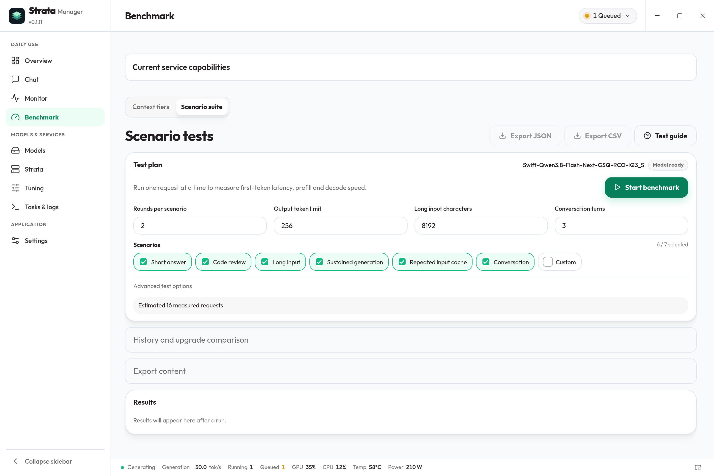
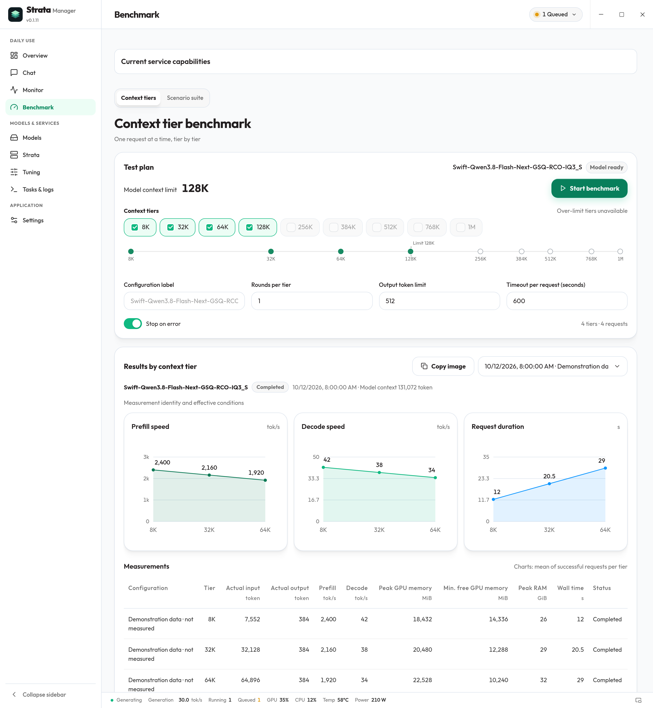

# Strata Manager user guide

## Current features

This guide covers the current stable release (v0.1.10), including daily features introduced since 0.1.7. Check the [latest release page](https://github.com/hongfaqiu/strata-manager/releases/latest) and the selected version's changelog for available packages and their contents.

- **Model downloads:** select a model in the list, then choose GPUs, context, KV and slots in its details. Assessment follows the current selection and preserves manual values. Unknown modes do not establish capacity; RAM, KV and per-GPU estimates are not an additive total.
- **Startup failures:** inspect stages, duration, reasons and sanitized evidence in Overview or Tasks, then open the relevant settings or logs. Read-only checks preserve stopped services; resource keywords in logs indicate suspected causes only.
- **Capabilities and chat:** support is available, unsupported, unverified or restart-required. Saved cache settings and live arguments are distinct. Stops, model switches or engine identity changes require a new check. Chat separates waiting, reasoning, tools and answer generation; TTFT, first-answer and total timing come from the request, and service IDs appear only when returned.
- **API checks and LAN:** explicitly test text, tool structure or image input in API and external assistants. Each check is bounded to 256 tokens and 60 seconds, never executes MCP and requires a ready model. Preview sharing settings before saving; multiple keys and backups are preserved, while restarting is separate. Server keys and application client credentials are managed independently.
- **Historical benchmarks:** save a pre-upgrade baseline, update the runtime manually, then rerun the original task serially. Saving a baseline starts no model and performs no update. Missing conditions, weak model/runtime identity or different cache state prevent direct speedup claims. JSON/CSV exports omit test prompts, answers and server error bodies by default; include them only explicitly.

The current release includes running-service inspection, reconnection to existing Manager backends and automatic connection when conditions permit on Windows. Interface language can follow the system or use ten bundled language packs. The desktop monitor has a visibility switch, three layouts, text sizing and ordered metrics with individual colors.

See the [daily experience notes](DAILY_EXPERIENCE.md). Images were recaptured from the actual current App/components on October 14, 2026, with isolated example data; their sources are recorded in the [screenshot record](screenshots/README.md) and [separate daily-experience manifest](screenshots/daily-experience/manifest.json). They do not establish measured inference. Actual scope is recorded in [verification](VERIFICATION.md).

Resource guidance, startup diagnostics, request evidence, API verification, LAN sharing and report comparison are documented in [Daily experience increment](DAILY_EXPERIENCE.md). Choose an installer from the [latest release](https://github.com/hongfaqiu/strata-manager/releases/latest); functionality and support remain tied to the selected release version.

[Website](https://strata-manager.cosfoc.com/?lang=en) · [Product overview](../README.md) · [Documentation](README.en.md) · [简体中文](USER_GUIDE.md)

[Download and try](DOWNLOAD.en.md) · [Troubleshooting](TROUBLESHOOTING.en.md) · [Support scope](DOWNLOAD.en.md#support-scope)

Strata Manager is an open-source desktop workspace for the Strata runtime and local model services. Runtime installation and matching Windows x64 ZIP engine updates, model configurations, and service startup, shutdown and recovery are its core; chat, monitoring, API usage statistics and tuning support that workflow. It is an independent community project. Inference capabilities, models, image input, reasoning, MCP tools and API protocols come from the installed Strata runtime and chosen model.

This guide describes the current stable release (v0.1.10). The [latest release page](https://github.com/hongfaqiu/strata-manager/releases/latest) and the selected version's changelog establish package availability and contents. Inspect the runtime in Strata first, then choose a configuration in **Models → My models**, select **Use**, wait for **Model ready**, and open Chat or copy the local API address. Manager manages supported installations on this computer; it does not manage remote nodes.

## Prepare or reuse a model

**Already used an earlier Manager version?** Valid model profiles and conversations are restored automatically, without automatically starting model services. Review My models before starting a new preparation; existing weights do not need to be downloaded again.

**Already have Strata elsewhere on this computer?** Inspect its detected runtime and version in Strata; an existing runtime does not need reinstalling. Missing-model diagnostics are separate from whether Strata exists. My models automatically lists discovered models without requiring import or use first. Add a search directory if detection misses yours.

Configurations using the same model are grouped, with modification dates and current/last-used markers. The active model and configuration remain visible while you browse alternatives. Choose a configuration and select Use: Manager registers a managed configuration and shows environment checks, startup and model loading. Weights stay in place, the original configuration is retained, and the managed service uses a copy.

On Windows, a running installation owned by another program must pass identity and activity checks before takeover. Unknown or busy processes are not forcibly stopped. Read the displayed reason if an installation needs repair or cannot be imported.

**Starting fresh?** Complete the installation guide in Strata before choosing or downloading a model. Manager downloads and verifies official source and prepares a private environment in its own data directory. The normal path does not require Git or a manually entered Python path. When Strata has already been detected, the repeated installation guide is hidden.

- Windows uses a suitable 64-bit Python 3.10+ when available. Otherwise, it can prepare a verified official Python installer for a private installation. Executing this fallback still needs acceptance on a clean machine without Python.
- Linux needs Python 3.10+, venv and ensurepip. Crash containment also needs a 64-bit Linux 5.9+ environment that permits pidfd, clone and close_range; managed child startup is refused when these are unavailable. Missing system dependencies produce instructions; Manager does not run sudo. Complete automatic preparation still needs real Linux acceptance.
- macOS (Apple silicon and Intel) and glibc Linux (x86_64 / aarch64): when no Python 3.10+ with venv is found — macOS itself ships 3.9 — the guide's environment check, the Strata install step and the Strata page show **Install Python**. It installs CPython 3.12.15 from python-build-standalone 20261009 (the build upstream `setup.sh` pins) into the app's `toolchains` folder, with progress and cancel. Download from GitHub or a GitHub proxy (GH Proxy / GHProxy, defaulting to the engine package proxy you chose); every source must match the official byte count and SHA-256. No administrator rights, PATH changes, or changes to the system or Homebrew Python. Later Strata installations use it automatically.

Then open **Models → Download models**, selecting the available quantization, context and image options. Strata's setup prepares the engine and weights. The catalog follows the reviewed runtime; it is not an installer for every model or arbitrary GGUF file. Model downloads may be large: check free disk space, RAM, VRAM and driver requirements against the [Strata documentation](https://github.com/Niko1221/Strata).

Model cards show the actual data destination, free space on each destination disk and estimated additional bytes after counting reusable weights or resumable files. The background checks again before preparation and refuses to start downloads when space is insufficient or unknown. These are estimates from the reviewed installer, not proof of driver, memory or complete dependency readiness. Importing an existing model does not require downloading or reserving room for another full copy of its weights.

### Choosing a model: official and community builds

"Choose a model" (step 3 of the guide and the Download models page) lists official models by default, and recommendations come only from them. The speed on the right of each row is marked **estimate**. It is not measured on your machine. It is upstream Strata's published measurement of the same model and quantization on a reference machine: for Mac, the M5 Max 128 GB, or the M4 32 GB / M1 Max 34 GB SSD-streaming runs; for PC, the RTX 5070 12 GB, RX 9070 XT 16 GB or R9700 32 GB. "≤" means your machine is weaker than the reference and "≥" means it is stronger. Time to first token is a 4K prompt divided by the measured prompt speed. Hover a row or open its details to see the exact source and which figures are extrapolated.

**When a Mac's memory cannot hold the whole model (48 GB, for example)**, the engine streams the experts from the internal SSD. It runs and does not fail; it is just slower (see upstream [MAC.md](https://github.com/Niko1221/Strata/blob/main/docs/MAC.md)). Swift, Coder and Qwen3.6 do not run on Mac. Official Unsloth is unavailable on Mac too, because the app's Mac installer takes only Qwen3.8-Flash-Next Q2_0 / IQ3_XXS / IQ3_S. All of them are greyed out with the reason.

Switch to **Community · uncensored** to see third-party builds:

- **Built-in entries:**
  - SC117 abliterated: one-click download.
  - alesha-pro's control vector build: downloadable on PC. On Mac the vector is not ported, so it equals the official build.
  - OrcaRouter: on PC it uses the existing ORCA import. It is unavailable on Mac.
- **Discovered entries:** GGUFs from Hugging Face that Strata can run directly. They refresh every 24 hours, or when you click **Refresh**. When offline, the cache or the built-in entries are shown.
- **Risks:**
  - Community builds have their safety refusals removed and are not verified by Strata.
  - The MTP draft head is not abliterated.
  - Long-running agents may start refusing again.

  Use them only where you can take responsibility for the results.
- **Download:** files are pinned to one commit of the source repository and each one is checked for size and SHA-256. The official installer then packs them into a separate `community/` data folder with its own configuration, so official models are never overwritten. The details state the estimated extra disk before you download. Files byte-identical to official shards (alesha-pro's shards, for example) are hard-linked from the official download already on this PC after a SHA-256 check, so they are not downloaded again.

### Put models and engines on another drive

Model files are usually 70–120 GB. By default they live in `Strata-data` next to the Strata engine (on Windows, in the app data folder on C:), and they can go on any drive: click **Change** under **Strata → Storage locations**, in the first-run guide's environment check, or at the top of **Download models**, then choose a folder. Choosing a drive root such as `D:\` uses a `Strata-data` folder inside it.

- **Move my existing models there (recommended)**: files are copied to the new folder and verified (SHA-256), the paths in model configurations are updated and the new location is remembered, and only then are the old files deleted. On the same drive the folders are moved in place without extra space. If anything fails or you cancel, the old files and setting stay as they were. Models cannot start while files move; stop a running service first.
- **Use the new location for new downloads only**: existing models stay where they are and keep working.

The location is shared with official Strata (the `data_dir` in Strata's `settings.json`), so the official installer uses it too.

**New engine install location** decides where Strata engines installed from now on (about 1 GB) go; installed engines stay where they are. Paths are limited to 120 characters and must be a real folder the current user can write to (not a link or redirected folder).

Open the separate **Tasks & logs** sidebar menu for preparation, download and update tasks, actual log output and downloaded bytes when available. Use the task's supported cancel or retry action after correcting an error. A completed, verified preparation appears in My models without replacing your current selection. Select **Use** when you are ready to switch.

## Start chatting

Select Use and wait for **Model ready**. A healthy API process and a loaded model are different states; a service that has started may still be loading weights.

Chat includes multiple conversations, streaming replies, Markdown and text attachments. Image input, reasoning controls and MCP tool events require support from the imported or prepared Strata runtime and model; they are not guaranteed for every installation. Use the attachment control or drop a supported file into Chat. Text attachments are limited to 512 KiB per file; images require the service to report image support.

Use the sampling controls for supported request settings. MCP tools also require configured servers with available tools; enabling the option alone does not add a tool or make an unsupported model capable of using it.

Chat sampling settings apply to subsequent requests. File-based startup settings are edited inside Models, as described below.

Use the stop control to cancel your active reply. Partial content can remain in the conversation. A slow first reply may include loading or prompt processing, especially with a long document; it is not the same measurement as steady answer generation.

MCP servers can execute tools and may contact other systems according to their own configuration. Review the tools you enable and their permissions.

## Runtime configuration

Choose a configuration in **Models → My models** and select **Runtime settings** to open the **Runtime configuration** secondary page inside Models. Graphical controls cover context, KV, memory, caching, CPU, prefill, speculation, server, vision, sampling and network settings. Suggested choices also accept custom values. The full argument list and other JSON fields remain editable; use the JSON view to inspect or edit the original structure.

Saves validate JSON and write atomically with a backup. Discovered configurations can be inspected and edited before using a model, without starting it. File-based changes generally require a service restart; saving does not prove the running service uses the new values. A saved service configuration records its name, address, environment and config path; it does not create or copy model weights.

## Connect a local API client

The Overview service card's API integration entry provides code, Cherry Studio, OpenCode and Claude Code guides, with copyable configuration generated from the current service address and model name.

Copy the address shown by Manager rather than assuming a fixed port. Select the API supported by your client and runtime:

| Client protocol | Typical API path |
| --- | --- |
| OpenAI Chat Completions | `/v1/chat/completions` |
| OpenAI Responses | `/v1/responses` |
| Anthropic Messages | `/v1/messages` |

For an OpenAI-compatible client, the base URL commonly includes `/v1`; follow that client's URL convention to avoid duplicating the path. Use the configured API key if the runtime requires one. Endpoint support depends on the installed Strata version.

Keep the client timeout long enough for model loading and lengthy prompts. Check readiness and the current address before changing client settings. Manager's local-only scope does not provide remote-node management.

## Window, background and startup

An independent background process manages imported or prepared services. Reopening the desktop app reconnects to the background for the same user. Opening the app or signing in starts only the lightweight background, without enabling model services from a saved selection. Enable a model manually from Overview's **Recently enabled** entry or select a configuration and **Use** in My models. A stopped service shows **Not started**, which is not a service failure. Parameter comparisons live in Tuning; task diagnostics have their own **Tasks & logs** menu.

**Minimize to tray when closing the window** is enabled by default and keeps a running API available. Disable it to show an exit confirmation and stop managed services on close. The dialog offers Don't ask again; Settings can re-enable the prompt. Left-click the tray to open the interface, or right-click for service status and shortcuts. **Stop services and quit** ends managed services.

**Release model memory** frees RAM and VRAM while keeping model files and the API process; load it again when needed. **Remove saved configuration** removes Manager's registration while preserving the original configuration and weights. A model that is already loaded does not show a redundant Load button.

Settings provides:

- **Start the background service at sign-in:** start only the local background; enable model services manually.
- **Keep the running model ready:** keep the model loaded after manually enabling its service. When off, configure idle memory release while retaining the API and loading the model on the next use. This does not enable a model when opening the app or signing in.
- **Recover the service automatically:** retry an enabled managed service up to three times after a crash. Deliberately stopped services remain stopped; repeated failures surface diagnostics. This does not promise recovery from every API failure or stalled process.

Cold background startup, legacy registration handoff and app upgrades preserve stopped services. An app or background upgrade attempts to restore a service and its previous model-loading state only when it verified that the managed service was actually running before the switch. A saved selection or registration is not a request to start it. Follow diagnostics if recovery fails; restoring a UI selection does not establish model or API recovery. Strata updating, existing-model load recovery and a short API inference have been tested on one Windows machine. Complete app updates across versions and other environments still require separate acceptance; see the [verification record](VERIFICATION.md#特定-windows-机器的-strata-0142-实机更新) for scope.

Appearance follows the system by default. Language and theme are in Settings, the last entry in the sidebar's Application group. Strata management is its own navigation page.

See [support scope](DOWNLOAD.en.md#support-scope) for current platform and usage limits. Linux containment requires the environment described above and covers descendants that stay in the managed process group; it does not establish cleanup of every MCP tool that creates its own session.

Login-startup status validates the registration, background file and full hash, data directory and enabled flag. Damaged or foreign entries show diagnostics rather than being claimed. Follow the reason to restore the app background files or resolve conflicts, then configure startup again. A valid status does not establish a real sign-out/sign-in test; operating-system policies may still prevent login startup.

## Read background health

Overview shows a **Background health check** for the current running service owned by Manager. A live process, a healthy API and a loaded model are separate states.

Open the top-right service status for recent throughput/GPU trends, VRAM/RAM usage, context progress and available service controls. The bottom bar shows throughput, running/queued requests, CPU/GPU, temperature and power. Idle throughput is labelled as the last generation. Failed sampling retains history while pausing live values; reconnection waits for fresh metrics. Trends remain in the current window only, with at most 3 minutes and 60 points.

Choose **Open floating monitor** in the bottom bar or enable **Show monitor** in Desktop monitor settings. The separate strip is closed by default and shows metrics only; layout and text size determine its dimensions. Drag anywhere, or use right-click/Shift+F10 for navigation, pinning and sampling. Two rows are the default, with compact and panel alternatives, 8–36px text, and 1–8 ordered metrics from eleven with individual colors. Labels default on; status text and edge snapping default off. Closing the strip preserves the main app. A stopped background or model stays stopped: sampling never launches, upgrades or restores services. See the [system explanation](SYSTEM.en.md) for component relationships and persistence.

| Status | What to do |
| --- | --- |
| API healthy | Check the separate model-loading status before chatting. |
| Verifying an API failure | Wait for a fresh result and inspect diagnostics if it persists. |
| Repeated API failures | The current process is preserved. Inspect diagnostics and decide whether to retry or stop it. |
| Busy or under maintenance; check deferred | Let the active request, loading or maintenance finish. |
| Full state not yet verified / waiting for a fresh check | Treat the result as unknown rather than healthy or failed. |

Health checks defer while verified work or maintenance is active. Repeated failures while idle are reported; the check itself does not stop or restart a process. The service-recovery setting is a separate policy for a managed service that exits, with bounded attempts as described above.

### Custom ports, LAN access and GPU power limits

In a model's Runtime configuration → More startup settings → Network access and power, set an API port from 1 to 65535. Bind to `127.0.0.1` for local use or `0.0.0.0` for LAN access; other devices use `http://this-computer-LAN-IP:port/v1`. A specific local interface IP is also supported. Saved changes apply on the next start or restart; the running service keeps its existing address until then. Clients use the same API key saved in shared settings. Check the system firewall if the port is unreachable.

On Linux, expanding a running service from a specific IP to a wildcard on the same port requires stopping it first or choosing another port. A failed preflight preserves the current service.

Set the GPU power limit in watts and select a GPU index (default 0). An explicit value is applied through NVIDIA `nvidia-smi`; startup checks the driver's supported range and permissions and reports failures. Leave it empty to use the driver's existing limit. Normal service shutdown or a failed start restores the previous limit, unless another program has changed it. Restoration cannot be guaranteed after a power failure or a forced backend termination; check the GPU's current limit afterward.

## Read API usage

Open **Monitor → API usage** for today, the last 24 hours or the last 7 days. Monitoring appears before usage and shows current service and hardware activity; usage charts show historical requests, tokens, cache reuse, latency, prefill and decode speeds. Today uses your local timezone. Metadata is retained in local SQLite for **90 days**, collection continues when the usage page is closed, and records remain after exiting and reopening the app.

| Measurement | Meaning |
| --- | --- |
| HTTP requests | Incoming API requests, including failures and token-count requests |
| Inference runs | Model work performed within a request; one tool-assisted request can include several runs |
| Tool calls | MCP/tool activity counted separately from HTTP requests and model runs |
| HTTP token usage | Usage reported for the API response |
| Inference workload | Token work across observed runs; do not add it to HTTP usage as a total |
| First-output latency | Waiting time to the first observed output |
| Total duration | Time observed for the complete request |
| Prefill speed | Prompt-processing rate where timing information is available |
| Decode speed | Output-generation rate where enough timing information is available |
| Cache reuse | Reported reuse; a repeated prefix can behave differently from a fresh prompt |

Success rate uses completed requests; unfinished requests are excluded. Failures, cancellations and interruptions are distinct outcomes. Missing counters stay **unknown**, not zero. Source labels are unknown when the client supplies no identifiable label.

Check collection state and coverage before interpreting a quiet chart. Older or modified runtimes may not be supported, and collection gaps are labeled. Metadata from before observation began cannot be reconstructed as complete usage history. Large model loads, long prompts and tool calls can explain latency without indicating a service fault.

Request history supports custom times, client, actual model, outcome and time order, with pagination. Pages keep the same boundary for newly ingested records until refreshed; an active request can still acquire its final status. Older records without an observed model remain unknown rather than being assigned the current model.

CSV export opens the system save dialog and exports metadata matching the current range and filters. Each export allows at most 5,000 rows; narrow the range or filters for larger results. Cancelling the dialog writes no file. Prompts, responses, reasoning, tool arguments and keys are excluded.

## Local storage and privacy

Usage analytics records metadata without prompts, responses, reasoning, attachments, tool arguments or API keys. Chat history and attachments are stored separately on your computer; metadata-only collection does not mean the app stores no conversation content.

**Request-body capture** is separate from metadata collection. Open advanced diagnostics, choose 5, 15 or 30 minutes, and enable temporary capture on an idle managed runtime that supports it and passes identity checks. It keeps up to 100 requests' inputs, reasoning and responses in RAM. Disabling capture or expiry erases captured bodies while the service keeps running; it does not alter `api_monitor`. Unsupported runtimes, unknown identity or active requests prevent automatic enablement.

**Manage an existing `api_monitor` setting separately.** An imported configuration may already enable the upstream viewer. The app marks it as user-configured and does not claim or disable it. For persistent configuration, set `api_monitor: true` in runtime configuration and restart as prompted; set it to `false` and restart to disable it. This route has no app-managed temporary expiry; lease cleanup applies only to temporary capture enabled by the app.

Runtime and model downloads, update checks, and configured MCP tools can make network requests. Local inference does not make every enabled integration offline. Keep API keys and diagnostic exports private, and review exports or logs before sharing them.

## Compare tuning results

Choose Everyday chat, Coding and Agent, or Long document analysis to measure complete tasks. The report separates fresh inputs, repeated prefixes, session switches, sustained generation, tool loops or document retrieval. Optional vision checks require image support already configured for the current model; unchecked vision remains untested.

Request candidates compare PCIe budget (`pcie_frac`) and MTP threshold (`spec_min_p`). Advanced settings also offer up to four independent restart candidates: CPU worker count, asynchronous swapping, prefill chunk size and VRAM reserve. Each restart candidate changes one setting. Manager checks support, sampled resource headroom and recovery records, then measures **current A → candidate B → restored A**. VRAM-reserve candidates may only increase the current reserve; unknown original values or effective support cause rejection.

The comparison temporarily occupies the model; other requests may wait or report busy. Measurements preserve the current configuration. Stop the comparison with its cancel control when needed; cancellation affects the comparison's own request. Applying a recommendation is a separate action that restarts the managed service.

Review task duration, first-output latency, speeds, caching, task quality, observed configuration state and resource samples together. A recommendation requires repeatable gain beyond baseline drift, passing task-quality and resource checks. Resource samples are not a capacity guarantee, and a startup ceiling does not prove the effective prefill chunk size.

**Run short request diagnostics only** retains the short-chat, Code and Chinese probes. These reports do not establish full-scenario acceptance and cannot apply new recommendations. The Code probe checks `merge_sorted(a,b)` on empty lists, duplicates, negative numbers, unequal lengths and fixed randomized inputs, including input preservation. Only supported syntax is parsed; generated Python is not executed. Historical reports remain readable and previously applied parameters can be restored, but a new application requires a fresh measurement. Results cover the selected workloads, not general model quality, every Agent workflow or unchecked vision and capacity scenarios.

Applying a result saves a recovery record, restarts the owned service and checks model loading. If application fails, Manager attempts to restore the original configuration and service. Recovery can also fail; follow the displayed diagnostics, repair the cause and prepare the model again rather than assuming it is available. Applying or restoring parameters briefly affects the local API; avoid concurrent maintenance and active client work during these actions.

Controlled tests validate the comparison and recovery workflow. Real speed improvements need a report from the actual model, hardware and workload. Screenshot metrics and demonstration timing are not GPU benchmarks.

## Benchmark

Start the model manually, open the Benchmark workspace and select the current configuration. The workspace defaults to **Context tiers**, with **Scenario suite** in the other tab. Both modes send one request at a time. Historical concurrent reports remain readable; this increment does not provide a new concurrent stress entry point.

| Mode | How to use it |
| --- | --- |
| **Context tiers** | Choose tiers within verified capacity, retaining template and output margins. Run each tier serially; unavailable tokenization is explicitly marked as an estimate. |
| **Scenario suite** | Select Short answer, Code review, Long input, Sustained generation, Repeated input cache, Conversation or Custom. Set warmup, repeated runs and input/output lengths, then compare results by scenario. |

Reports separate time to first token (TTFT), first-answer timing, request duration, P50/P95, token counts, input-processing and generation rates, cache reuse and resources. Missing metrics remain unknown. Incomplete conditions or model/runtime identity based only on file metadata prevent direct speedup claims.

Follow progress or cancel a running test. The workspace coordinates with chat, tuning and other inference operations. Historical reports stay on this computer and can be exported as JSON or CSV. Compare runs using the same model, configuration, scenarios and hardware conditions.

These workspaces, reports and the historical condition comparison below were recaptured from actual current components on October 14, 2026. Isolated example data does not establish GPU measurements.

## Shared settings and model configuration

Shared settings centralizes background policy, appearance and common chat defaults: reasoning effort, temperature, Top P, Top K, output limit, seed, system prompt and chat MCP. Changes apply to the next request. New models inherit these defaults; existing per-model chat settings are preserved. Enable Current model uses common chat defaults to opt in. Adjusting sampling in the chat drawer gives that model its own settings. Model IDs, structured output and fixed prefixes remain model specific. Common defaults apply only to chat in this app; sharing sampling with other clients is a separate setting on the selected service.

API and external assistants provides API setup instructions, service access keys and MCP configuration. Selecting a connection target never starts or switches a model; credentials remain separate in the system vault. VRAM and sessions provides tools for the current model, keeping controls visible and disabled while its service is stopped.

Model configuration retains model paths, context, KV, startup VRAM, vision and the full JSON. Applying startup changes still requires an explicit restart. Shared settings never rewrites existing model configuration files in bulk.

## Structured output and session tools

Chat supports text, JSON and JSON Schema output, sampling controls and reusable long-document prefixes. Common actions are visible directly; the question mark beside a heading opens help. Runtime configuration is organized by category, with advanced editors retaining access to the full configuration.

Model preparation exposes supported download sources and GPU selection, local GGUF inspection, and runtime-supported Swift/IQ3_S quantization. Availability depends on the installed runtime and selected model; unavailable actions show the reason.

Service tools expose slots, session save/restore, prefill progress and supported VRAM adjustment. MCP shows servers, tools and model-supported tool calls. Existing-runtime management handoff on Windows and expert tuning candidates have dedicated controls. Session files remain local and should be handled as data containing user input.

Dynamic VRAM adjustment depends on runtime support. If the engine rejects adjustment in low-RAM resident mode, the app explains the reason.

## Application updates

Automatic checks are enabled by default, on launch and every 12 hours. An available update adds a badge to the top-left version entry. Click that entry to open the dedicated App updates page, review release notes and confirm downloading and installation. The installed version's bilingual notes are bundled for offline viewing. Disable automatic checks to check manually. Failures preserve the current app and can be retried; installation checks that the background is idle. Downloads show progress, and the updater verifies official Tauri signatures with the embedded public key.

Choose a Windows installer, AppImage or DEB from the [latest release](https://github.com/hongfaqiu/strata-manager/releases/latest) or the [website download section](https://strata-manager.cosfoc.com/en/#get-started). App updates use the `latest` channel.

Application, Strata runtime and model weights are separate. Updating Manager does not normally require another model-weight download. Read the version's release notes for restart and recovery behavior.

See [Download and try](DOWNLOAD.en.md) for versions, packages and the current support scope.

Tauri update signatures are separate from Windows Authenticode publisher signing. The project does not currently have a Windows publisher certificate; follow the download guide when your system displays an installation warning.

## Update the Strata runtime

Strata is a global runtime managed on its own **Strata** page. View installed and upstream versions, official release links and notes. The update package matches the current engine type by default; you can also select an available package. After confirmation, the task downloads the official engine ZIP and same-version source, verifies and extracts them into a preparation directory, then backs up and replaces program files while retaining weights, configurations and conversations.

Packages automatically match the current CUDA12, CUDA13 or HIP engine across all download sources. If the engine cannot be identified, select a package manually. Expand **Package details** to view and copy the official URL, size and SHA256. Every source is verified against the official manifest; mismatches are rejected.

Choosing or canceling a file only changes the dialog selection. The final confirmation creates the update task and authorizes any required service stop. A local ZIP skips only the engine download; same-version source and official release information still require network access. Local ZIPs and fixed mirror URLs are bound to the selected version and must be selected again when it changes; built-in proxies and custom templates can follow new releases.

The Strata page's **Download settings and test** section is collapsed by default and remains available when the runtime is up to date. Switch between official GitHub, GH Proxy, GHProxy, custom HTTPS and a local ZIP; saved choices prefill update confirmations. Built-in proxies follow the current official release and matched package, with official downloading always available. Third-party speed and availability depend on the network. Local ZIPs and fixed URLs are bound to one release; custom templates support `{url}`, `{version}` and `{asset}`.

**Test download source** creates no update task and stops no service. Local checks read the complete file and verify its size and SHA256. Network checks read a sample of at most 64 KiB and report HTTP Range support; a successful sample check does not verify the complete file, which is still checked during installation. An unsupported background version returns an explicit upgrade message without automatically handing off the background service or stopping a model for the test.

Interrupted or canceled engine downloads retain their received bytes. Confirming the update again attempts to resume them. Network errors, HTTP 408/429 and server errors receive at most three automatic attempts, with the reason and downloaded byte count in the task log. A server that ignores byte ranges triggers a complete download instead. Downloads no longer have a five-minute whole-file deadline; sixty seconds without a network response triggers a retry. A SHA256 mismatch deletes the partial file, while complete verified caches can be reused.

Automatic checks share the app's default-enabled setting and still require confirmation. Preparation preserves the current service; switching follows idle and process-identity checks and briefly interrupts the local API. The updated service is checked, and failure or cancellation after switching attempts to restore backups and previous registrations. Recovery failures retain diagnostics for repair before retrying.

This workflow uses upstream release information and the matching engine package. From Strata 0.2.0 upstream publishes a signed feed with `.tar.gz` engine packages: Windows x64 and Linux x86_64 (from v0.2.9, desktop and the headless Server) pick the CUDA 13, CUDA 12 or AMD HIP package for the detected GPU, verify the feed signature, the package SHA256 and the signed in-package manifest, then trial-start the new engine and roll back automatically if it fails. Earlier releases still update from the official Windows x64 ZIP. Missing platform assets preserve the existing installation; first installs on Linux still build from source, and later version updates use the official prebuilt engine. External startup hooks, unknown processes or incompatible dependencies are rejected before stopping services.

### Install a specific Strata version

**Install a specific version** on the Strata page lists every upstream Strata release, newest first, marked **Current**, **Latest** and **Pre-release**. Versions without a package for this platform cannot be chosen. After you pick one, the button says whether it upgrades, downgrades or reinstalls; it opens the same confirmation as a normal update, with the same download sources, service-stop authorization and logs.

Downgrades use the same installation path as upgrades. From 0.2 on, the signed update feed is verified (signature, schema, channel, expiry) and its version must equal the chosen version; legacy ZIPs are checked against the SHA256 that GitHub publishes. The package is unpacked into a staging directory and the new engine gets a trial start; if that fails, the previous version is restored automatically. A chosen version is used for that installation only and does not change the record of the latest version. Before a downgrade the dialog warns that an older engine may not support models, quantizations or options added later; model files and configurations are kept and you can upgrade again; if the two versions need different Python packages, the installation is refused and the current version stays.

With **Stay on {version} and stop update prompts** checked (the installed version), releases newer than the pinned version no longer prompt for an update, and the Strata page shows **Pinned** instead of an update button. The pin only affects prompts: you can still choose any version from the list, and unchecking it restores automatic prompts.

An existing Strata installation was updated to 0.1.42 on one Windows machine: all 24 original configuration files were unchanged, the existing model was loaded again with its 131072 context setting preserved, and a short API request returned `OK`. This was not a full 128K-context test and does not establish compatibility for every GPU/model, Linux or the complete UI flow. Updating the Tauri app itself across versions requires separate acceptance. See the [verification record](VERIFICATION.md#特定-windows-机器的-strata-0142-实机更新) for details.

## Common questions

**My installation was not found.** Select its Strata folder and read the detection reason. Verify the source, Python environment, configuration and model files before attempting import.

**Do I have to download the model again?** No. My models lists discovered configurations directly, and earlier valid Manager configurations are restored. Add a search directory if needed; prepare a new model only when you need additional weights.

**The API is up, but Chat cannot answer.** Check Model ready, task logs and available memory. Loading on demand can delay the first request. Avoid starting another large GPU workload during loading.

**Another application cannot connect.** Check the copied loopback address, API path, model readiness, key and timeout. A client that cannot reach local services may have its own network restrictions.

**The app refuses to take over a running installation.** Read the identity or activity diagnostic. Wait for active work to finish; an unverified process is not stopped merely because it occupies the expected port.

**Usage is empty or has unknown values.** Check collection state, runtime compatibility and coverage. Missing observation is different from zero usage.

**Tuning did not find an improvement.** Keep the current settings if gains are not repeatable. Compare complete tasks with your own workload; cache state and background activity can affect results.

**The window closed, but GPU memory is still used.** Closing to the tray is enabled by default and keeps the model available. Use Release model memory to retain the API without loaded weights, or Stop services and quit to end managed services. Disabling closing to the tray makes window close stop services and exit.

**An update check or download fails.** Read the displayed error and retry when the network or release source is available. The current application remains installed. Check [Download and try](DOWNLOAD.en.md) for release availability and [Troubleshooting](TROUBLESHOOTING.en.md) for the next steps.

## Screenshots and project credits

The README images show the actual App rendered with isolated in-memory RPC example data. Model status, metrics and chat content are examples; their source is disclosed outside the images in the README and website. The cover combines those screens. Neither the screenshots nor the cover demonstrate inference speed or real API usage.

This independent community application builds on [Niko1221/Strata](https://github.com/Niko1221/Strata) and its official interface. See [MIT](../LICENSE) and [third-party notices](../THIRD_PARTY_NOTICES.md); Outfit uses SIL OFL 1.1, and separately downloaded models retain their own licenses.
