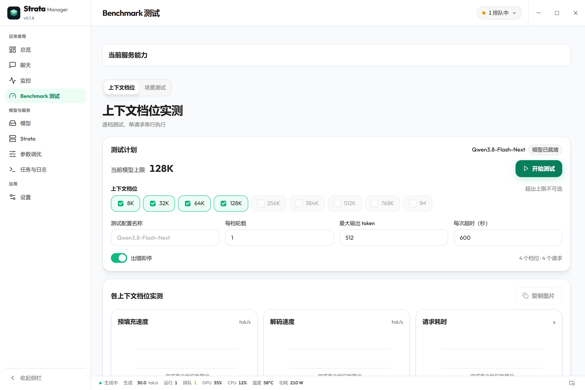
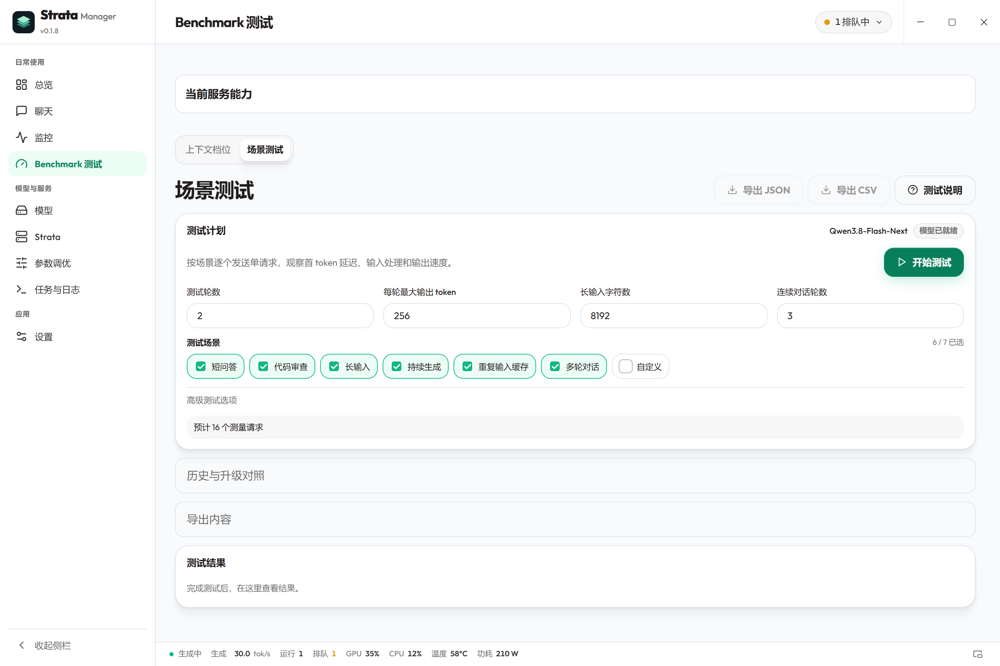
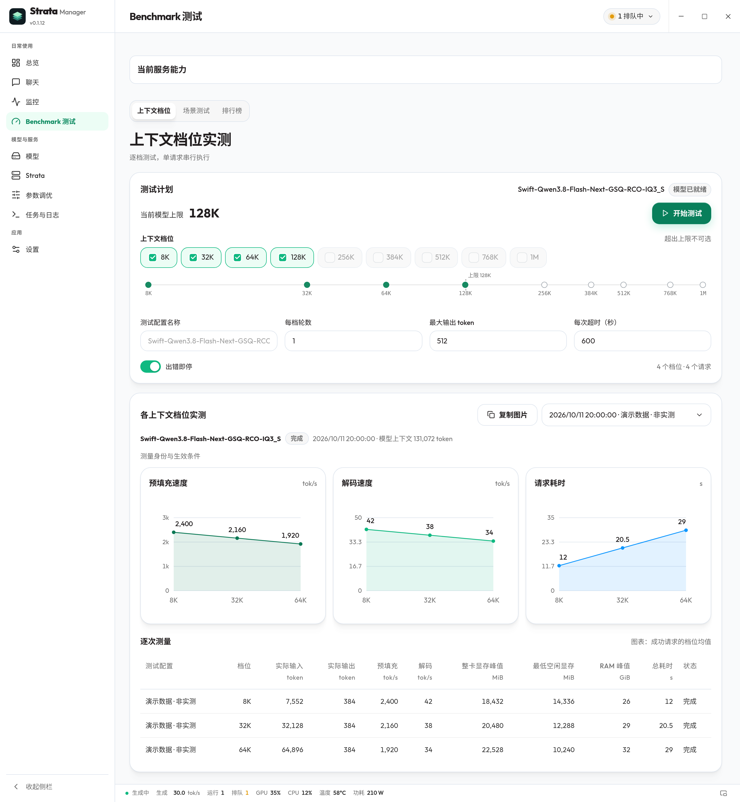
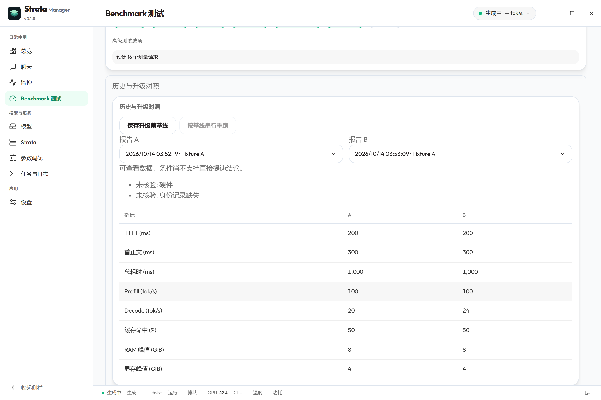

# Strata Manager 使用指南

## 当前版本功能

本指南覆盖当前稳定版（v0.1.10）功能，含自 0.1.7 起引入的日常能力。安装包及其内容以[最新发布页](https://github.com/hongfaqiu/strata-manager/releases/latest)和对应版本更新日志为准。

- **模型下载**：先在列表选择模型，再进入详情统一选择显卡、上下文、KV 与槽位。资源评估随当前选择变化；保留手动值，未知模式不提供容量承诺。RAM、KV 与逐卡显存分项不能直接相加为总容量。
- **启动失败**：在总览或任务查看失败阶段、耗时、原因及脱敏证据，打开对应配置或日志。只读检查保留停止状态；资源日志关键词仅为疑似原因。
- **能力与聊天**：服务能力区分可用、不支持、未核验和需要重启。已保存缓存配置与当前运行参数分别显示；停止、换模型或引擎身份变化后需要重新核验。聊天分别展示等待、思考、工具及正文；TTFT、首正文和总耗时使用本次请求证据，服务请求 ID 只在实际返回时展示。
- **API 验证与局域网**：在“API 与外部助手”手动验证文本、工具结构或图片。每次最多 256 token／60 秒，工具不执行 MCP；模型未就绪时不能验证。共享设置先预览再保存，保留多密钥和备份，重启独立执行。服务端密钥与应用客户端凭据分别管理。
- **历史 Benchmark**：保存升级前基线后手动更新运行时，再复用原任务串行重跑；保存基线不会启动模型或更新运行时。条件缺失、弱模型／引擎身份或缓存不同会阻止直接提速结论。默认 JSON／CSV 导出省略测试文本、回答和服务错误正文，可显式勾选包含内容。

当前版本在 Windows 提供运行中服务状态、连接已有管理后台与符合条件时的自动连接；语言可跟随系统或选择十种随包资源；桌面监控改用显示开关，提供三种布局、字号与指标排序配色。

说明与截图见[日常体验增量](DAILY_EXPERIENCE.md)。配图于 2026-10-14 从当前版本的实际 App／组件重新采集，使用隔离示例数据；[截图记录](screenshots/README.md)和[日常体验独立 manifest](screenshots/daily-experience/manifest.json)记录来源。图片不代表推理验收，实际范围见[验收记录](VERIFICATION.md)。

资源建议、启动诊断、API 验证、局域网共享及历史对照见[日常体验增量](DAILY_EXPERIENCE.md)。安装包从[最新发布页](https://github.com/hongfaqiu/strata-manager/releases/latest)选择；功能与支持范围以所选发布版本为准。

[官网](https://strata-manager.cosfoc.com/?lang=zh) · [返回产品介绍](../README.zh-CN.md) · [文档目录](README.md) · [English](USER_GUIDE.en.md)

[下载与体验](DOWNLOAD.md) · [故障排查](TROUBLESHOOTING.md) · [支持范围](DOWNLOAD.md#支持范围)

Strata Manager 是开源的 Strata 运行环境与本地模型服务管理桌面工作台，核心是 Strata 安装与匹配的 Windows x64 ZIP 引擎更新、模型运行配置，以及服务启动、停止和恢复；聊天、监控、API 使用统计与调优是配套工具。它是独立社区项目，推理能力、模型、图像输入、思考、MCP 工具与 API 协议由已安装的 Strata 和模型提供。

本指南面向当前稳定版（v0.1.10）；安装包及所含功能以[最新发布页](https://github.com/hongfaqiu/strata-manager/releases/latest)和所选版本的更新日志为准。先在 Strata 页面检查运行环境，再从“模型 → 我的模型”选择配置并点击“使用”，等待“模型可用”后聊天或连接本机 API。应用管理这台电脑上的受支持安装，已有权重保持原位；不管理远程节点。

## 第一次使用

### 已经有 Strata 或模型

1. 打开 Strata 页面查看检测到的运行环境和版本。已有环境不必重新安装；模型文件缺失等诊断与运行环境是否存在分开显示。
2. 打开“模型 → 我的模型”，发现的模型会直接展示，无需先使用或导入。旧版 Manager 的有效配置与聊天记录会自动恢复，但不会因此自动启动模型服务；检测遗漏时添加 Strata 搜索目录。
3. 同一模型下选择运行配置，查看修改日期、当前使用和上次使用标记。当前活跃模型与配置显示在卡片中，浏览其它配置不会立即切换服务。
4. 点击“使用”，应用登记受管配置并显示环境检查、启动和加载进度，等待模型可用后聊天。原有模型保持原位，原配置保留，受管服务使用配置副本。

可导入的已有 Strata 模型不需要再次下载权重。在 Windows 检测到由其它程序运行的实例时，应用先核验来源与活动状态；身份不明或正在处理请求的进程不会被强制停止。如果无法接管，查看提示和日志后再处理。

### 还没有安装

1. 先打开 Strata 页面完成安装引导，应用下载并校验官方源码，创建私有运行环境；检测到已有 Strata 时不显示重复安装引导。
2. 再打开“模型 → 下载模型”，选择模型及可用的量化、上下文和图像选项。目录以应用核验过的运行时为准，不是任意模型或任意 GGUF 文件的通用安装器。
3. 在侧栏独立的“任务与日志”中查看下载与准备进度。命令成功且资产核验通过后，模型自动加入列表；多份配置有歧义时按提示选择。
4. 点击“使用”。应用检查环境、启动服务并加载模型。

准备新模型不会自动替换当前选择。失败可以重试，也可以取消；权重较大时首次准备会需要较长时间。

模型卡片会显示实际数据目录、各目标磁盘的可用空间和预计新增量，并扣除可复用的权重或断点文件。开始准备前后台会再次检查；空间不足或无法确认时不会启动下载。数字是按所选模型及已核对的安装器规则估算，不能保证驱动、内存或全部依赖都已就绪。导入已有模型不需要再次准备或满足整套权重的下载空间。

### 把模型和引擎放到其他磁盘

模型文件通常有 70–120 GB。默认放在 Strata 引擎旁边的 `Strata-data`（Windows 上在 C 盘的应用数据目录下），可以改到任意磁盘：在 **Strata** 页的「存储位置」、首次向导的「检查环境」或「下载模型」页顶部点「更改」，选择文件夹。选择盘符根目录（如 `D:\`）时会自动使用其中的 `Strata-data` 文件夹。

- **把已有模型移动过去（推荐）**：先复制到新位置并逐字节核对（SHA-256），再更新模型配置里的路径、记住新位置，最后删除旧文件。同一个磁盘内直接移动文件夹，不占额外空间。中途失败或取消，旧文件和设置都保持不变。移动期间不能启动模型，需要先停止正在运行的服务。
- **只让新下载使用新位置**：已有模型留在原处，照常使用。

这个位置和官方 Strata 共用（写在 Strata 的 `settings.json` 的 `data_dir`），官方安装器也会使用它。

「新引擎安装位置」决定之后新安装的 Strata 引擎（约 1 GB）放在哪里；已安装的引擎留在原位置，不会移动。路径最长 120 个字符，必须是当前用户可写的真实目录（不能是符号链接或重定向目录）。

Windows 检测 64 位 Python 3.10+；未找到时提供经 SHA256 校验的官方 Python 私有安装路径。Linux 需要 Python 3.10+、venv 和 ensurepip；缺失依赖会给出提示，应用不执行 sudo。Linux 崩溃保护还需要允许 pidfd、clone 和 close_range 的 64 位 Linux 5.9+ 环境；不支持时拒绝启动受管子进程。缺 Python 的完整安装分支仍待干净机器验收。

macOS（Apple 芯片与 Intel）和 glibc Linux（x86_64 / aarch64）找不到带 venv 的 Python 3.10+ 时（macOS 自带的是 3.9），引导页「检查运行环境」「安装 Strata」和 Strata 页会出现「一键安装 Python」：把 python-build-standalone 20261009 的 CPython 3.12.15（与上游 `setup.sh` 固定的构建相同）装到应用的 `toolchains` 目录，显示进度，可以取消。可选 GitHub 或 GitHub 代理（GH Proxy / GHProxy，默认沿用引擎包已选的代理）下载，任何来源都必须与官方字节数和 SHA-256 一致；不需要管理员权限，不改 PATH，不改动系统或 Homebrew 的 Python。之后安装 Strata 会自动使用它。

## 日常使用

| 页面 | 可以做什么 |
| --- | --- |
| 总览 | 查看当前服务、用量和资源；未启用时从“最近启用”或选择模型入口手动启用，停止状态显示“未启动” |
| 模型 | 自动展示已有模型、切换运行配置、编辑图形化参数与 JSON、准备新模型 |
| Strata | 全局运行环境检测、安装、版本与更新日志、Windows x64 ZIP 更新进度 |
| 聊天 | 管理多个会话、流式回答、Markdown 与文本附件；图片、思考和 MCP 事件需模型与运行时支持 |
| 调优 | 按用途测量完整任务，比较请求参数与受支持的重启候选，再决定应用或恢复 |
| 监控 | 服务与硬件监控、API 使用统计和趋势图、按需请求正文诊断 |
| 任务与日志 | 独立菜单，查看准备、下载、更新任务及日志，按任务支持的操作取消、重试或处理失败 |
| 设置 | 语言、主题、后台策略、登录自启动与应用更新；入口在侧栏“应用”分组最后 |

“关闭窗口后在后台运行”默认开启，关闭后独立后台继续提供已经启动的 API，重新打开应用会连接同一用户后台。关闭该选项后，关闭窗口会弹出退出确认并停止受管服务，可勾选“不再提示”；也可从设置重新开启询问。托盘左键打开界面，右键查看服务状态并执行快捷操作，“停止服务并退出”会结束受管服务。

“释放模型内存”释放 RAM 与显存，保留模型文件和 API 进程；再次使用时可加载回来。“移除保存的配置”删除 Manager 保存的配置登记，不删除原始配置或模型权重。服务已经加载模型时不会重复显示加载按钮。

打开应用或登录自启动只连接或启动轻量后台，不会因为保存过模型选择而启用模型服务。可从总览的“最近启用”入口手动启用，也可在“我的模型”选择配置后点击“使用”；未启用的模型显示“未启动”，并不代表服务故障。参数比较在独立调优页进行，任务排查在“任务与日志”中进行。

“运行期间保持模型就绪”在手动启用服务后保持模型加载；关闭后可设置空闲释放内存，保留 API 并在下次使用时加载。这项设置不会在打开应用或登录时自动启用模型。“自动恢复”仅针对已启用的受管服务异常退出，执行最多 3 次恢复尝试；主动停止后保持停止，连续失败会显示诊断，不保证自动解决所有 API 异常或卡死。

冷启动后台、恢复旧版登记和应用升级都保留原本停止的服务。应用或后台升级只有在切换前核验到受管服务实际运行时，才尝试恢复该服务及原模型加载状态；仅保留旧选择或登记不构成启动请求。恢复失败时按诊断处理，不能把界面选择已恢复当作模型或 API 已恢复。特定 Windows 机器的 Strata 更新、原模型加载恢复和短 API 推理已实测；完整应用跨版本更新及其他环境仍需分别验收，范围见[验证记录](VERIFICATION.md#特定-windows-机器的-strata-0142-实机更新)。

当前平台与实际使用限制见[支持范围](DOWNLOAD.md#支持范围)。Linux 崩溃保护要求满足前述运行环境，覆盖保留在受管进程组内的子进程；不能外推为所有另建会话的 MCP 工具都会被清理。

### 聊天、附件与运行配置

在聊天页新建或切换会话，通过附件按钮或拖放添加受支持文件。文本附件每个最多 512 KiB；图像需要服务报告图像支持。思考展示由模型返回内容决定，MCP 还需要已配置、可连接且有可用工具的服务器，打开选项本身不会增加工具能力。

聊天采样选项影响受支持的请求参数。使用停止回答按钮可取消自己的生成，已收到的部分内容可能留在会话中。

### 运行配置

从“模型 → 我的模型”选择配置并打开“运行配置”，在模型内的二级页面编辑。图形化界面按上下文、KV、内存、缓存、CPU、prefill、推测解码、服务、视觉、采样和网络等类别展示参数；下拉框提供建议，也支持自定义输入。完整参数与其它 JSON 字段可继续编辑，原始 JSON 视图用于直接检查配置。

“默认采样”里的“默认实验投影”有三个选项：开启、关闭、使用默认设置（删除 `sampling.experimental_speed_projection`）。它只给没带这个参数的请求当默认值，请求里的值和共享采样设置优先，聊天页的会话开关照常生效；引擎要先加载实验投影控制向量才有作用，这里不负责加载或下载。保存后重启模型生效。

保存前校验 JSON，并原子写入、保留备份。已发现但尚未使用的配置也能查看和编辑，不会因此启动模型。文件参数通常需重启服务生效；保存成功不等于正在运行的服务已采用新值。服务配置登记用于记录名称、地址、运行环境及配置路径，本身不会创建或复制模型权重。

登录自启动状态会核验登记项、后台文件及完整哈希、数据目录和启用标志；损坏或同名外部项会给出诊断，不会自动认领。按诊断恢复本应用的后台文件或处理冲突，再重新设置。状态有效不等于已完成真实注销/登录验证；系统策略也可能阻止登录启动。

## 阅读后台健康状态

总览的“后台健康检查”针对当前运行中的受管服务。进程存活、API 健康和模型已加载分别判断。

点击右上角服务状态可查看近期速度/GPU 趋势、显存与内存占用、上下文进度，并执行可用的服务操作。底栏集中显示速度、运行/排队请求、CPU/GPU、温度和功耗。速度空闲时标为“最近生成”；采集失败保留历史并暂停实时值，重连后等待新的成功采样。趋势仅保存在当前窗口内，最多最近 3 分钟、60 个点。

底栏“打开监控浮条”或“桌面监控”的“显示监控”开关可打开独立浮条，默认关闭，仅展示指标，窗口尺寸由布局与字号计算。支持任意位置拖动，右键或 Shift+F10 打开导航、置顶和采样菜单。默认清晰双行，也可选择紧凑单行或详细面板；字号 8–36px，从 11 项指标中选择 1–8 项并排序、逐项配色。标签默认开启，状态文字与贴边吸附默认关闭。关闭浮条不影响主应用；后台或模型未启动时保持未启动，不会为了采样启动、升级或恢复服务。组件关系与数据保存见[系统说明](SYSTEM.md)。

| 状态 | 如何处理 |
| --- | --- |
| API 健康 | 同时检查模型加载状态，再开始聊天 |
| 正在核验 API 异常 | 等待新的检查结果；持续异常时查看诊断 |
| API 连续异常 | 当前进程会保留；查看诊断后决定重试或停止 |
| 忙碌或维护中，延后检查 | 等待请求、加载或维护结束 |
| 尚未核验完整状态或等待新检查 | 按未知处理，不直接判断为健康或故障 |

巡检在核验到工作或维护时延后，连续空闲异常会显示诊断；巡检本身不会强行停止或重启进程。服务退出后的有界自动恢复是独立策略。

## 接入本机 API

总览服务卡片中的“接入 API”提供代码调用、Cherry Studio、OpenCode 和 Claude Code 指引，按当前服务地址和模型名生成可复制配置。

先确认模型可用，再查看总览或模型页显示的本机服务地址。把客户端所需的 Base URL/API 路径配置为对应地址，不需要创建远程服务档案。

按客户端与当前运行时共同支持的协议配置路径：

| 客户端协议 | 常见 API 路径 |
| --- | --- |
| OpenAI Chat Completions | `/v1/chat/completions` |
| OpenAI Responses | `/v1/responses` |
| Anthropic Messages | `/v1/messages` |

客户端要求 OpenAI Base URL 时，通常使用对应的 `/v1` 地址，而不是聊天页面的网址；遵循客户端约定，避免重复添加路径。配置了 API Key 时，客户端也要使用同一密钥。某些客户端自身不能访问本机服务，应用不会绕过它们的网络限制。

首次加载大型模型可能需要较长时间，客户端超时要匹配实际加载时间。连接失败时依次检查模型状态、显示的端口、API 路径、密钥和日志。

### 自定义端口、局域网访问与功耗

在模型的“运行配置 → 更多启动设置 → 网络访问与功耗”填写 API 端口（1–65535）。仅本机使用时监听 `127.0.0.1`；局域网共享时选 `0.0.0.0`，其他设备使用 `http://本机局域网IP:端口/v1`。也可绑定本机指定 IP。保存后启动或重启服务生效，当前运行地址在重启前保留。客户端使用公共设置中保存的同一 API Key；连不上时检查系统防火墙是否允许该端口。

Linux 运行中的服务若要在同一端口从指定 IP 扩大到通配监听，请先停止再启动，或改用其它端口；预检失败会保留当前服务。

GPU 功耗上限以 W 填写，并指定 GPU 编号（默认 0）。仅在配置该值时通过 NVIDIA `nvidia-smi` 应用；驱动支持范围和权限在启动时检查，失败会明确报错。留空恢复由驱动管理，服务正常停止或启动失败时恢复之前的上限。如果外部程序已修改上限，Manager 保留外部设置。断电或强制结束后台后不能保证自动恢复，请检查显卡当前上限。

## 阅读 API 用量

在“监控 → API 使用统计”选择今日、最近 24 小时或最近 7 天，可以查看请求趋势、成功率、失败/取消/中断、输入输出 tokens、缓存率、首个输出等待时间、总耗时、prefill 速度、解码速度、MCP 调用和最近请求。监控标签排在使用统计前面，两者分别展示当前运行状态与历史用量。

今日按本机时区计算。元数据在本机 SQLite 中保留 90 天，后台持续采集；关闭监控页面不会停止采集，退出后重新打开也会保留已有记录。

HTTP 请求、模型推理轮次和工具调用分别计数。一次 MCP 请求可能有多轮推理，token-count 请求只计 HTTP 请求；HTTP usage 与推理工作量不能相加当作总 token 用量。成功率排除未结束请求。

缺失值显示未知，不等于零。请同时检查采集状态、兼容性与断档；开始采集前的时间不代表完整统计。客户端没有可识别标签时显示为未知来源。

请求历史支持自定义时间、来源、实际模型、完成状态及时间排序，并可翻页。翻页保持同一次查询的新记录边界；点击刷新才纳入后来收到的请求。正在执行的请求仍可能更新完成状态。早期未记录实际模型的请求显示未知，不能根据当前模型补写。

导出 CSV 会打开系统保存对话框，仅导出当前时间和筛选条件下的元数据。单次最多 5,000 条，超过时需要缩小时间或筛选范围；取消保存不会生成文件。CSV 不包含提示词、回答、思考、工具参数或密钥。

## 数据与隐私

聊天历史保存在本机。API 使用统计只保存请求与推理元数据，不保存提示词、回答、思考、附件、工具参数或 API 密钥。

请求查看器的正文捕获是独立诊断功能，元数据统计不需要开启它。进入高级诊断，在支持该功能、身份已核验且空闲的受管运行时上选择 5、15 或 30 分钟，再开启临时捕获；最多在 RAM 保留最近 100 条请求的输入、思考和回答。点击“关闭并清空正文”或到期会清空捕获正文，服务继续运行，原 `api_monitor` 配置不变。能力不兼容、身份不明或仍有请求时，不提供自动启用。

**已有 `api_monitor` 配置单独管理。** 导入的原配置可能已经开启上游请求查看器，应用会标为用户配置并且不认领或关闭它。若需要这种持续配置方式，可在模型运行配置中设置 `api_monitor: true` 并按提示重启；关闭则设为 `false` 并重启。这条路径不享有应用临时租期，到期清理仅针对应用开启的临时捕获。

模型推理在本机，运行环境、模型与更新下载需要网络。MCP 工具按用户配置执行，可能访问外部服务；请根据自己的工具配置判断其行为。报告问题或分享诊断前，移除密钥、私人路径和聊天内容。

## 参数调优

选择日常聊天、编程与 Agent、长文分析用途后，应用测量完整任务，并分别检查新输入、重复前缀、会话切换、持续生成、工具闭环或长文检索。图像检查需当前模型已配置图像支持；未选择时保持未测试。比较期间模型被占用，其他请求可能等待或提示忙碌，建议先结束聊天和外部客户端工作。

请求候选比较 PCIe 预算（`pcie_frac`）与 MTP 阈值（`spec_min_p`）；高级设置还支持最多四个独立重启候选，分别调整 CPU 工作线程、异步换入、prefill 分块或显存预留。每次只改一个重启选项，后台核验能力、资源余量与恢复记录，再按“当前配置 A → 候选 B → 恢复 A”复测。显存预留候选仅允许增加现有值，原值或生效能力未知时不启动该候选。

报告包含任务耗时、首个输出等待时间、速度、缓存、质量检查、配置生效观测和资源样本。推荐要求收益超过基线波动，实际任务质量与资源检查通过；结果不稳定时保留原配置。资源采样不是容量保证，启动上限也不等于实际生效分块。

高级设置中的“仅运行短请求诊断”保留短对话、代码生成与中文长回答探针；此类报告不构成完整场景验收，不能据此新应用推荐参数。代码探针检查 `merge_sorted(a,b)` 对空列表、重复值、负数、长度差异与固定随机输入的正确性及输入保留，只解析受支持语法，不执行模型生成的 Python。旧报告可以查看和恢复已应用参数，新应用需重新测量。测试结果只覆盖所选场景，不替代一般模型质量、全部 Agent 工作流或未选择的视觉与容量检查。

采用结果会保存恢复记录、重启受管服务并检查加载；失败时尝试恢复原配置。恢复本身也可能失败，此时保留诊断，需要修复后重试。应用期间本机 API 会短暂受影响，请避免并行维护。实际 GPU 收益以模型、硬件和测试报告为准，截图中的示例数值不代表性能结果。

## Benchmark 基准测试

先手动启动要测试的模型，进入“基准测试”工作区，选择当前运行配置。工作区默认打开“上下文档位”，另一 Tab 为“场景测试”，两种模式均逐个发送请求；历史并发报告仍可读取，本轮不提供新的并发压力入口。

| 模式 | 使用方式 |
| --- | --- |
| **上下文档位** | 按服务核验容量选择档位，预留模板与输出余量；逐档串行运行，分词不可用时明确标为估算。 |
| **场景测试** | 选择短问答、代码审查、长输入、持续生成、重复输入缓存、多轮对话或自定义场景，设置预热、重复轮次和输入输出长度，按场景比较结果。 |

报告区分别展示首 Token 延迟（TTFT）、首正文时间、请求总耗时、P50/P95、Token 数、输入处理与生成速度、缓存复用，以及资源趋势；引擎未提供的指标保持未知。条件不完整或模型／运行时只有文件元数据时，不显示直接提速结论。

测试过程中可以查看进度或停止测试，工作区会协调聊天、调优等推理操作。历史报告保存在本机，支持导出 JSON 或 CSV；比较结果时使用相同的模型、运行配置、场景与硬件条件。

这些工作区、报告及下方历史条件对照图均于 2026-10-14 从当前版本的实际组件重新采集；隔离示例数据不代表 GPU 实测。

## 公共设置与模型配置

公共设置集中管理后台策略、外观和常用聊天默认值。公共聊天默认值包括推理强度、温度、Top P、Top K、输出上限、随机种子、系统提示词和聊天 MCP 开关，保存后用于下一次请求。新模型默认继承；已有模型的专用聊天设置保留，可用“当前模型使用公共聊天默认值”切换。聊天抽屉内调整采样后，该模型改为专用参数；模型名称、结构化输出和固定前缀等仍按模型保存。公共默认值仅作用于本应用聊天，“共享给其他客户端”仍是当前服务的独立功能。

“API 与外部助手”统一提供 API 接入说明、服务访问密钥和 MCP 配置。选择连接目标不会启用或切换模型；密钥按服务分别存入系统凭据库。“显存与会话”统一提供当前模型的运行工具，服务未启动时保留入口并禁用执行。

模型运行配置保留模型文件、上下文、KV、显存启动参数、视觉和完整 JSON。保存这些参数仍需显式重启模型生效；公共设置不会批量改写现有模型配置文件。

## 结构化输出与会话工具

聊天页可以选择普通文本、JSON 或 JSON Schema 输出，调整采样参数，复用长文档前缀。常用操作直接显示；标题旁的问号提供说明。运行配置按类别选择，完整配置仍可通过高级编辑入口修改。

下载模型时可以选择官方支持的来源和 GPU、检查本地 GGUF；可用量化包括运行环境支持的 Swift/IQ3_S。运行环境能力和当前模型决定哪些选项可用，缺少支持时显示具体原因。

服务工具提供槽位、会话保存与恢复、prefill 进度和运行时支持的显存调整；MCP 可查看服务器、工具及模型允许的工具调用。已有运行环境的管理交接入口适用于 Windows；专家调优候选有单独入口。会话文件保存在本机，应按包含输入内容的数据管理。

“公共设置 → API 与外部助手”中的“连接外部助手”默认通过本应用后台接入。检查连接后，将生成的配置添加到 Codex、Cursor、Claude Desktop 或 VS Code 的 MCP 设置；模型正在运行时也可以接入，无需交出管理权。助手的查询、启动、停止和安装操作使用本应用现有管理流程，安装先返回计划，明确确认后才创建后台任务。配置绑定当前选择的模型，停止操作会保留停止状态；断开助手连接不会停止本应用后台。

需要让助手独立管理 Strata 时，可选择“外部独立接管”。此模式使用官方 MCP，交接前必须停止同一安装目录内的服务、完成安装并断开现有助手连接。交接后本应用暂停该安装目录的启动、自动加载与恢复；显式切回本应用管理后才重新启用这些操作。默认接入需要本应用后台正在运行，后台不可用时应先打开本应用。

动态显存调整依赖运行时的支持；低 RAM 驻留模式下若上游拒绝调整，应用会显示具体原因。

## 应用更新

自动检查默认开启，在打开应用及每 12 小时检查新版本。发现更新后，左上角版本入口显示更新标签；点击版本入口可进入独立的应用更新页，查看更新日志并确认下载和安装。当前版本的中英文日志随应用打包，可离线查看。也可以关闭自动检查，手动检查更新。失败时保留当前版本并提供重试；安装前检查后台是否空闲。正式应用更新使用内置公钥验证 Tauri 签名，下载有进度显示。下载来源与引擎下载相同：未指定镜像时自动测速，任一来源失败后回退到官方 GitHub，界面会显示实际使用的来源。应用、Strata 运行环境和模型权重分别管理，更新应用无需重新下载模型。

通过[最新发布页](https://github.com/hongfaqiu/strata-manager/releases/latest)或[官网下载区](https://strata-manager.cosfoc.com/#get-started)选择 Windows 安装包、AppImage 或 DEB。应用通过 `latest` 更新通道提供更新。

版本、安装包和当前支持范围见[下载与体验](DOWNLOAD.md)。Tauri 更新签名与 Windows 发布者代码签名不同，本项目目前没有 Windows Authenticode 发布者证书；请按下载说明处理系统的安装提示。

## 更新 Strata 运行环境

Strata 是全局运行环境，在独立 Strata 页面管理。查看本机版本、上游最新版本、官方发布与更新日志，更新包默认匹配当前引擎类型，也可以选择可用包。确认更新后，任务下载官方引擎 ZIP 及同版本源码，校验并解包到准备目录，再备份和替换程序文件，保留模型权重、配置与会话。

更新包默认按当前 CUDA12、CUDA13 或 HIP 引擎自动匹配，各下载来源共用这套规则；无法识别时可手动选择。展开“包信息”可查看和复制官方链接、大小及 SHA256。所有来源均按官方清单校验，不匹配会拒绝安装。

选择或取消本地文件只改变弹窗选项，最终确认后才创建更新任务并按需要停止服务。本地 ZIP 仅省去引擎包下载，同版本源码和官方发布信息仍需网络；本地 ZIP 和固定镜像地址绑定所选版本，版本改变后需重新选择；内置代理和自定义模板可跟随新版本。

Strata 页的“下载设置与测试”默认收起，已是最新版本时也可使用。可切换官方 GitHub、GH Proxy、GHProxy、自定义 HTTPS 或本地 ZIP，保存后预填更新弹窗。两个内置代理会跟随当前官方版本和匹配包，可随时切回官方；第三方来源的速度和可用性取决于网络。本地 ZIP 和固定地址绑定版本，更新后需重选；自定义模板支持 `{url}`、`{version}`、`{asset}`。

“测试下载来源”不创建更新任务或停止服务：本地文件检查完整大小与 SHA256；网络只读取最多 64 KiB 样本，并报告服务器是否支持 HTTP Range 续传。网络测试通过不代表完整文件校验通过，安装时仍会校验完整文件。后台版本尚不支持测试时会明确提示更新后台，不会为测试自动交接或停止模型。

引擎下载中断或取消后，已收到的部分会保留；重新确认更新时会尝试断点续传。网络错误、HTTP 408/429 和服务端错误最多自动尝试三次，并在任务日志中显示原因和已下载字节数。服务器不支持续传时会重新下载完整文件。下载不再限制整包必须在五分钟内完成；连续六十秒没有响应时才按网络故障重试。SHA256 不符的部分文件会删除，已通过校验的完整缓存可复用。

自动检查与应用更新共用默认开启的设置，发现可安装版本后仍需确认。准备阶段保留当前服务；实际切换在核验空闲和进程归属后进行，期间本机 API 短暂不可用。更新后核验服务，失败或切换后取消会尝试恢复备份和原登记；恢复失败会保留诊断，需处理后再重试。

该流程使用上游发布信息与匹配的引擎包。Strata 0.2.0 起上游改为签名 feed 加 `.tar.gz` 引擎包：Windows x64 与 Linux x86_64（v0.2.9 起，桌面版与无头 Server）都按检测到的显卡匹配 CUDA 13、CUDA 12 或 AMD HIP 包，校验 feed 签名、整包 SHA256 和包内签名清单，再试启动新引擎，失败自动回滚。更早的版本仍按 Windows x64 官方 ZIP 更新。平台缺包时保留现有安装；Linux 首次安装仍走源码方式，之后的版本更新使用官方预编译引擎。外部启动命令、未知进程或不兼容的依赖会在停服务前拒绝更新。

### 安装指定的 Strata 版本

Strata 页的“安装指定版本”列出上游发布的所有 Strata 版本，从新到旧排列，并标出“当前”“最新”和“预发布”。本平台没有安装包的版本显示为不可选。选中一个版本后，按钮会说明这是升级、降级还是重新安装；点击后打开与普通更新相同的确认弹窗，下载来源、服务停止授权和安装日志都一样。

降级和升级使用同一条安装流程：0.2 起的版本先验证签名更新清单（签名、格式、通道、有效期），并要求清单里的版本与所选版本一致；旧版 ZIP 按 GitHub 提供的 SHA256 校验。之后在准备目录解包，试启动新引擎，试启动失败会自动恢复原版本。所选版本只用于这一次安装，不会改写“最新版本”的检查记录。降级前弹窗会提醒：旧引擎可能不支持之后才有的模型、量化或参数；模型文件和配置不会删除，可以再升级回来；两个版本的 Python 依赖不同时会拒绝安装并保持当前版本。

勾选“固定在 {版本}，不再提示更新”（{版本} 为本机当前版本）后，比固定版本更新的发布不会再弹出更新提示，Strata 页也不显示更新按钮，只显示“已固定”。固定只影响提示，仍然可以在版本列表里手动选择任何版本；取消勾选即恢复自动提示。

已在一台 Windows 机器验证既有 Strata 更新至 0.1.42：24 份原配置保持不变，原模型恢复加载，131072 上下文设置保留，短 API 请求成功返回 `OK`。这不是填满 128K 上下文的测试，也不证明所有 GPU/模型、Linux 或完整界面操作均兼容；Tauri 应用自身跨版本更新需另行验收。详细范围见[验证记录](VERIFICATION.md#特定-windows-机器的-strata-0142-实机更新)。

## 遇到问题

| 现象 | 建议 |
| --- | --- |
| 找不到已有安装 | 选择 Strata 文件夹，检查源码、Python、配置及模型文件的诊断 |
| API 启动了，模型还不能聊天 | 等待模型加载，查看任务和日志；API 在线与模型可用是两个阶段 |
| 客户端连接失败 | 检查本机地址、路径、模型状态、超时与密钥 |
| 统计为空或未知 | 查看采集状态、兼容性和断档；旧版或改动过的运行时可能不支持完整观测 |
| 调优没有提速 | 保留原配置，用实际工作负载复验，不把缓存命中等同完整任务提速 |

详细步骤见[故障排查与反馈](TROUBLESHOOTING.md)。提交问题时说明系统、应用版本、操作步骤和脱敏后的错误信息。

## 截图与项目来源

README 和官网展示实际应用界面，模型状态、聊天和数值使用隔离的示例数据，在图片外说明来源；不作为真实推理、API 使用量或 GPU 性能证据。

本项目是基于 [Niko1221/Strata](https://github.com/Niko1221/Strata) 的独立社区桌面应用。许可与上游来源见 [MIT](../LICENSE) 和[第三方声明](../THIRD_PARTY_NOTICES.md)；模型权重独立准备，遵循提供方许可。
